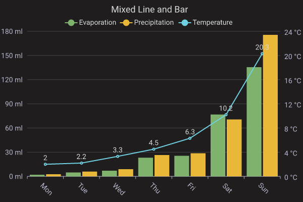
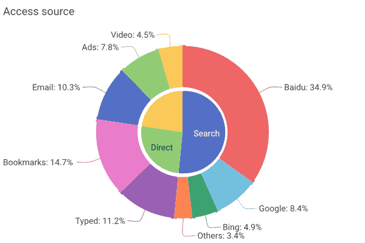
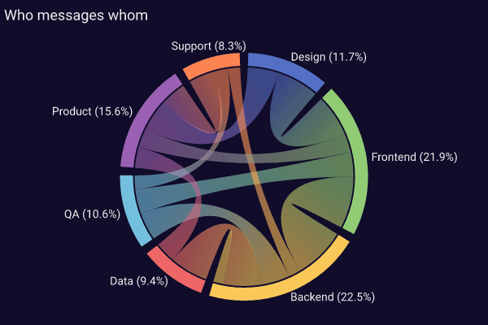
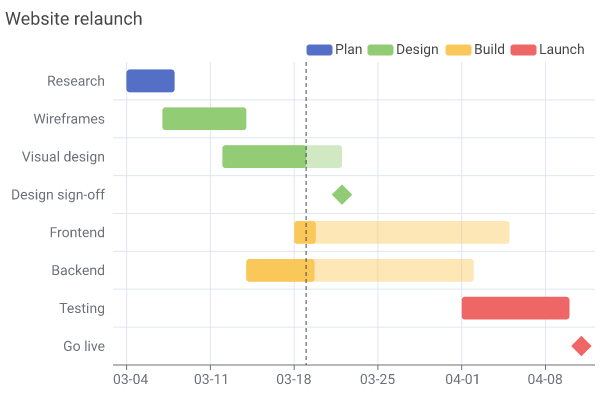
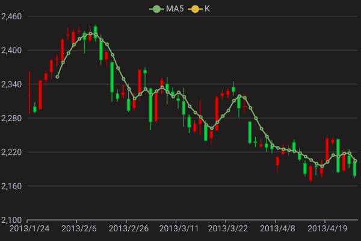
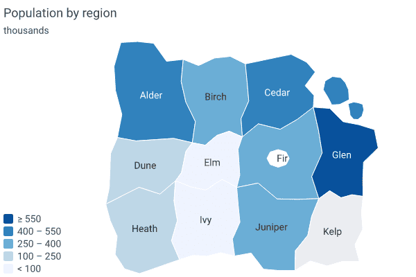
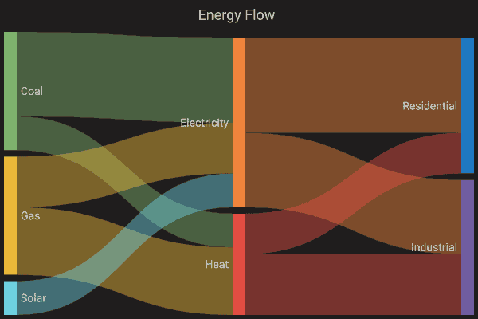
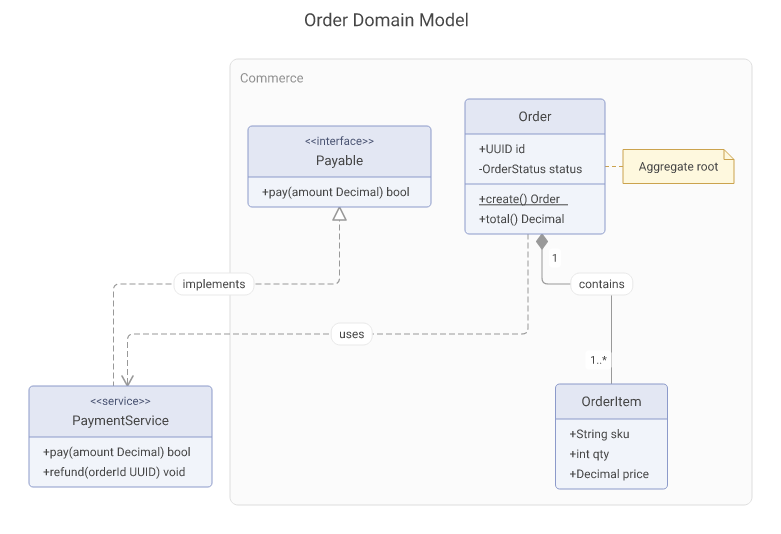
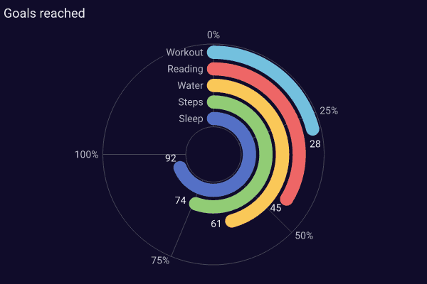
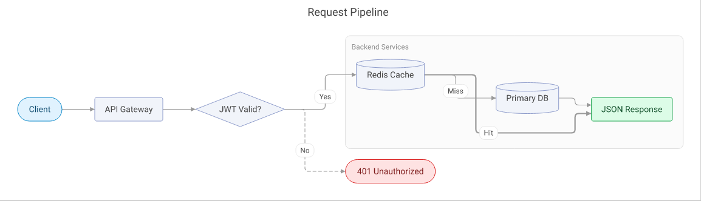

# charts-rs

[中文](./README-zh.md)

**Charts for Rust, without a browser.** `charts-rs` draws 28 chart types — plus `MultiChart` composition (29 default type names) and 13 Mermaid diagram types with the optional `mermaid` feature —
as SVG, and as PNG, JPEG, WebP or AVIF, from a few lines of Rust or from a
JSON document, in the manner of Apache ECharts.

[![Crates.io][crates-badge]][crates-url]
[![Apache licensed][apache-badge]][apache-url]
[](https://github.com/vicanso/charts-rs/actions/workflows/test.yml)

[crates-badge]: https://img.shields.io/crates/v/charts-rs.svg
[crates-url]: https://crates.io/crates/charts-rs
[apache-badge]: https://img.shields.io/badge/license-apache2-blue.svg
[apache-url]: https://github.com/vicanso/charts-rs/blob/main/LICENSE

https://github.com/user-attachments/assets/0a191257-4b5e-4562-8501-76db3b5fe7ea

<p align="center">
  <a href="https://github.com/vicanso/charts-rs/blob/main/docs/gallery.md"></a>
  <a href="https://github.com/vicanso/charts-rs/blob/main/docs/gallery.md"></a>
  <a href="https://github.com/vicanso/charts-rs/blob/main/docs/gallery.md"></a>
</p>

<p align="center">
  <a href="https://github.com/vicanso/charts-rs/blob/main/docs/gallery.md"></a>
  <a href="https://github.com/vicanso/charts-rs/blob/main/docs/gallery.md"></a>
  <a href="https://github.com/vicanso/charts-rs/blob/main/docs/gallery.md"></a>
</p>

<p align="center">
  <a href="https://github.com/vicanso/charts-rs/blob/main/docs/gallery.md"></a>
  <a href="https://github.com/vicanso/charts-rs/blob/main/docs/gallery.md#mermaid"></a>
  <a href="https://github.com/vicanso/charts-rs/blob/main/docs/gallery.md#polar-bar"></a>
</p>

<p align="center">
  <a href="https://github.com/vicanso/charts-rs/blob/main/docs/gallery.md#mermaid"></a>
</p>

<p align="center">
  <a href="https://github.com/vicanso/charts-rs/blob/main/docs/gallery.md"><b>All 28 chart types, MultiChart &amp; Mermaid diagrams →</b></a>
  &nbsp;·&nbsp;
  <a href="https://charts.npmtrend.com/"><b>Try it in the browser →</b></a>
</p>

## Why charts-rs

- **Nothing to install but the crate.** No headless browser, no Node.js: a
  chart is a function call that returns SVG. Made for reports, e-mails, bots
  and dashboards that are rendered on a server.
- **Fast.** An SVG in well under a millisecond, a PNG in a few milliseconds
  ([benchmark](#benchmark)).
- **28 chart types + `MultiChart` + 13 Mermaid diagrams**, from bars, lines and pies to
  candlesticks, heatmaps, sankey, gantt charts and maps — plus pure-Rust,
  zero-dependency Mermaid rendering under the optional `mermaid` feature — and
  several of them in one picture.
- **Rust or JSON.** A typed API, or a JSON document with the same options.
  Every key is [documented](./docs/json.md) and checked: a typo is an error
  with a hint, not a chart that silently ignores it. Exposes two-tier
  (`Essential` / `Full`) JSON Schemas, `chart_catalog()`, structured
  multi-issue validation (`validate_chart_json`), `RenderLimits`, and named
  GeoJSON registration (`register_geo_json`) for MCP / LLM servers.
- **Themes and fonts.** Ten themes and your own; your own fonts (TTF, OTF,
  TTC), Chinese, Japanese and Korean ones included, for the memory of the
  file.

## Quick start

```toml
[dependencies]
charts-rs = "2"
```

```rust
use charts_rs::BarChart;

let mut chart = BarChart::new(
    vec![
        ("Email", vec![120.0, 132.0, 101.0, 134.0, 90.0]).into(),
        ("Search", vec![220.0, 182.0, 191.0, 234.0, 290.0]).into(),
    ],
    ["Mon", "Tue", "Wed", "Thu", "Fri"].map(String::from).to_vec(),
);
chart.title.text = "Visits".to_string();

let svg = chart.svg().unwrap();
```

The same chart from JSON — what a service gets from a request, or a
configuration file:

```rust
use charts_rs::BarChart;

let chart = BarChart::from_json(
    r#"{
        "title_text": "Visits",
        "x_axis_data": ["Mon", "Tue", "Wed", "Thu", "Fri"],
        "series_list": [
            {"name": "Email", "data": [120, 132, 101, 134, 90]},
            {"name": "Search", "data": [220, 182, 191, 234, 290]}
        ]
    }"#,
)
.unwrap();

let svg = chart.svg().unwrap();
```

As an image, with the `png` feature (`jpeg`, `webp` and `avif` are features
of their own):

```toml
[dependencies]
charts-rs = { version = "2", features = ["png"] }
```

```rust,no_run
use charts_rs::{LineChart, svg_to_png};

let chart = LineChart::from_json(
    r#"{
        "x_axis_data": ["Mon", "Tue", "Wed"],
        "series_list": [{"name": "Email", "data": [120, 132, 101]}]
    }"#,
)
.unwrap();

let png = svg_to_png(&chart.svg().unwrap()).unwrap();
std::fs::write("visits.png", png).unwrap();
```

Or render a Mermaid diagram without a browser (with the `mermaid` feature; see
[Guide](./docs/guide.md#mermaid-diagrams)):

```toml
[dependencies]
charts-rs = { version = "2", features = ["mermaid"] }
```

```rust
# #[cfg(feature = "mermaid")]
# {
use charts_rs::{MermaidChart, mermaid_to_svg, mermaid_validate};

let src = "flowchart LR\n  A[Client] --> B{Gateway}\n  B -->|OK| C[(DB)]";
mermaid_validate(src).unwrap();
let svg = mermaid_to_svg(src).unwrap();
assert!(svg.starts_with("<svg"));

// Disable SVG <a> links for untrusted Mermaid input:
let mut safe_chart = MermaidChart::new(src);
safe_chart.allow_links = false;
assert!(safe_chart.svg().unwrap().starts_with("<svg"));
# }
```

## Features

- **Charts**: bar, horizontal bar, line, pie, radar, scatter and bubble,
  candlestick, table (with sparklines in its cells), heatmap, funnel,
  waterfall, calendar, gauge, treemap, box plot, sunburst, sankey, tree,
  graph, parallel, theme river, histogram, polar bar, chord, gantt, map,
  lines, bullet — and `MultiChart`, which puts several on one canvas, their
  plots lined up one above the other.
- **Mermaid** (optional `mermaid` feature): pure-Rust, zero-extra-dependency
  SVG rendering and syntax validation (`mermaid_validate`) for 13 diagram types
  (`flowchart` / `graph`, `sequenceDiagram`, `stateDiagram` / `stateDiagram-v2`,
  `classDiagram` / `classDiagram-v2`, `erDiagram`, `mindmap`, `quadrantChart`,
  `pie`, `gantt`, `sankey-beta`, `xychart-beta`, `radar-beta` / `radar`,
  `treemap-beta` / `treemap`), inheriting the active `charts-rs` theme and
  composable in `MultiChart`. Uses default rounded orthogonal edge routing with
  side ports (`flowchart`, `state`, `class`, `er`) and per-subgraph `direction`,
  plus YAML frontmatter / `%%{init}%%` config passthrough, `accTitle` /
  `accDescr` SVG accessibility metadata, protocol-allowlisted `click` links
  (`allow_links`), v11 `@{ shape }` nodes, multiline Markdown labels, and gantt
  `excludes` / `includes` / `vert`.
- **Series**: stacked and 100% stacked, bars mixed with lines, two y axes,
  smooth and step lines, areas, bands and error bars, mark lines, points and
  areas, regression curves, marginal histograms, density contours, missing values.
- **Axes**: categories, values, time and logarithmic scales, with titles and
  label formats.
- **Looks**: themes, gradients, a legend on any side, labels that keep out
  of each other's way, SVG animation, hover tooltips, a copyright line or a
  watermark anywhere on the chart.
- **Output**: SVG — compact on request, 20–30% smaller — and PNG, JPEG, WebP
  or AVIF at any size.

## Documentation

| | |
|---|---|
| [Guide](./docs/guide.md) | Building charts in Rust and from JSON, axes, labels, fonts, images |
| [JSON reference](./docs/json.md) | Every option of every chart: its type, its default, what it does |
| [llms.txt](./llms.txt) | Compact LLM & MCP-ready reference (APIs, schemas, chart catalog, Mermaid spec) |
| [llms-full.txt](./llms-full.txt) | Full LLM bundle (`llms.txt` + Guide + JSON reference, built with `make llms`) |
| [Gallery](./docs/gallery.md) | Every chart type and its variants |
| [Mermaid architecture & design](./docs/mermaid-design.md) | Pure-Rust Mermaid engine architecture, layout engines, and adapter design |
| [Themes](./theme.md) | The ten built-in themes |
| [Maps of China](./asset/geo/china/README.md) | GeoJSON of the provinces of China and of the cities of each, ready for a `MapChart` — in the repository, not in the crate |
| [Examples](./examples) | `cargo run --example bar`, `cargo run --example mermaid --features mermaid`, and ten more |
| [API docs](https://docs.rs/charts-rs) | The Rust API on docs.rs |
| [Changelog](./CHANGELOG.md) | What changed, and how to move from 1.x to 2.0 |
| [Web demo](https://charts.npmtrend.com/) | Edit the JSON, see the chart ([source](https://github.com/vicanso/charts-rs-web)) |

## Benchmark

The SVG of a chart is generated in well under a millisecond. Turning it into
a PNG takes a few milliseconds: parsing the SVG, rasterizing and encoding
it. Charts of 600 × 400 pixels, on one thread of an Apple M4 Pro, with Rust
1.99:

| Chart | SVG | PNG, from the SVG |
|-------|----:|------------------:|
| Bar: 4 series of 7 values, one of them a line, with labels | 41 µs | 1.7 ms |
| Line: 2 series of 100 points, smooth and filled | 158 µs | 3.4 ms |
| Pie: 12 slices | 52 µs | 1.4 ms |
| Sankey: 8 nodes, 10 links | 71 µs | 1.2 ms |
| The bar chart at 1200 × 800 pixels | 41 µs | 3.4 ms |

These are the numbers of `cargo bench --features png`
([`benches/bench.rs`](./benches/bench.rs)), which measures the SVG of more
charts as well. They depend on the machine.

## Minimum supported Rust version

charts-rs 2.x builds with Rust 1.88 or newer (edition 2024). The MSRV may
rise in a minor release; the change is noted in the changelog.

## License

This project is licensed under the [Apache-2.0 license].

[Apache-2.0 license]: https://github.com/vicanso/charts-rs/blob/main/LICENSE
