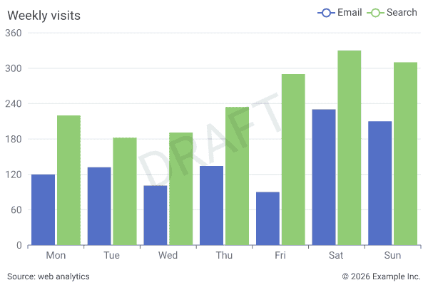
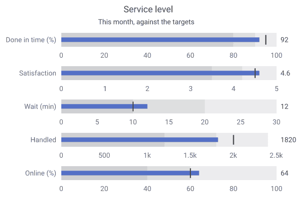
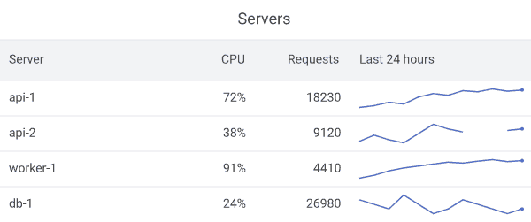
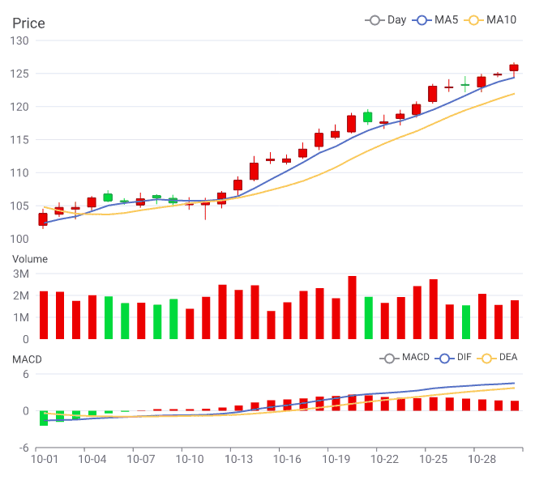

# 使用指南

[English](./guide.md)

如何用 `charts-rs` 生成图表：两种创建方式、需要多解释几句的参数、字体与输出。所有 JSON 参数见 [JSON 参数参考](./json-zh.md)，各图表的效果见[图表一览](./gallery.md)。

- [创建图表](#创建图表)：[使用 Rust](#使用-rust)、[使用 JSON](#使用-json)、[两种方式的参数对应](#rust-与-json-中的参数)
- [输出](#输出)：[图片](#图片)、[精简 SVG](#精简-svg)
- [数据与标签](#数据与标签)：[空值](#空值数据点)、[标签格式化](#标签格式化占位符)、[标签防重叠](#数据标签防重叠)、[版权声明与水印](#版权声明与水印)
- [坐标轴](#坐标轴)：[数值轴与时间轴](#数值轴与时间轴)、[坐标轴标题](#坐标轴标题)
- [图表](#图表)：[折线区间带](#折线区间带)、[气泡图](#气泡图)、[边际直方图](#边际直方图)、[密度等高线](#密度等高线)、[直方图](#直方图)、[极坐标柱状图](#极坐标柱状图)、[和弦图](#和弦图)、[甘特图](#甘特图)、[地图](#地图)、[流向线](#流向线)、[子弹图](#子弹图)、[表格中的迷你图](#表格中的迷你图)、[上下排列的图表](#上下排列的图表)
- [字体](#字体)

## 创建图表

### 使用 Rust

```rust
use charts_rs::{
    BarChart, Box, SeriesCategory, THEME_GRAFANA
};
let mut bar_chart = BarChart::new_with_theme(
    vec![
        ("Evaporation", vec![2.0, 4.9, 7.0, 23.2, 25.6, 76.7, 135.6]).into(),
        (
            "Precipitation",
            vec![2.6, 5.9, 9.0, 26.4, 28.7, 70.7, 175.6],
        )
            .into(),
        ("Temperature", vec![2.0, 2.2, 3.3, 4.5, 6.3, 10.2, 20.3]).into(),
    ],
    vec![
        "Mon".to_string(),
        "Tue".to_string(),
        "Wed".to_string(),
        "Thu".to_string(),
        "Fri".to_string(),
        "Sat".to_string(),
        "Sun".to_string(),
    ],
    THEME_GRAFANA,
);
bar_chart.title.text = "Mixed Line and Bar".to_string();
bar_chart.legend.margin = Some(Box {
    top: bar_chart.title.height,
    bottom: 5.0,
    ..Default::default()
});
bar_chart.series_list[2].category = Some(SeriesCategory::Line);
bar_chart.series_list[2].y_axis_index = 1;
bar_chart.series_list[2].label_show = true;

bar_chart
    .y_axis_configs
    .push(bar_chart.y_axis_configs[0].clone());
bar_chart.y_axis_configs[0].formatter = Some("{c} ml".to_string());
bar_chart.y_axis_configs[1].formatter = Some("{c} °C".to_string());

println!("{}", &bar_chart.svg().unwrap());
svg_to_png(&bar_chart.svg().unwrap()).unwrap();
```

### 使用 JSON

各图表的 JSON 文档可以使用的全部键（类型、默认值和作用）见 [JSON 参数参考](./json-zh.md)。

```rust,no_run
use charts_rs::{BarChart, svg_to_png};
let bar_chart = BarChart::from_json(
    r###"{
        "width": 630,
        "height": 410,
        "margin": {
            "left": 10,
            "top": 5,
            "right": 10
        },
        "title_text": "Bar Chart",
        "title_font_color": "#345",
        "title_align": "right",
        "sub_title_text": "demo",
        "legend_align": "left",
        "series_list": [
            {
                "name": "Email",
                "label_show": true,
                "data": [120.0, 132.0, 101.0, 134.0, 90.0, 230.0, 210.0]
            },
            {
                "name": "Union Ads",
                "data": [220.0, 182.0, 191.0, 234.0, 290.0, 330.0, 310.0]
            }
        ],
        "x_axis_data": [
            "Mon",
            "Tue",
            "Wed",
            "Thu",
            "Fri",
            "Sat",
            "Sun"
        ]
    }"###,
).unwrap();
println!("{}", bar_chart.svg().unwrap());
svg_to_png(&bar_chart.svg().unwrap()).unwrap();
```

### Rust 与 JSON 中的参数

两种方式的参数相同，本文档统一用 JSON 参数名来称呼它们。在 Rust 中，共享的参数按所属元素分组——`title`、`sub_title`、`legend`、`x_axis`、`grid`、`series`、`tooltip`——JSON 参数名就是字段路径用 `_` 连接：

| JSON | Rust |
|------|------|
| `"title_font_size": 18` | `chart.title.font.size = 18.0` |
| `"legend_position": "bottom"` | `chart.legend.position = Some(Position::Bottom)` |
| `"x_axis_data": [...]` | `chart.x_axis.data = vec![...]` |
| `"series_label_font_color": "#333"` | `chart.series.label.font.color = "#333".into()` |
| `"tooltip_show": true` | `chart.tooltip.show = true` |

例外：`x_boundary_gap` 对应 `x_axis.boundary_gap`，`x_axis_type` 对应 `x_axis.kind`，y 轴配置的参数去掉 `axis_` 前缀（`"axis_min"` 对应 `y_axis_configs[0].min`），热力图的 `series` 对象对应 `heatmap_series`（`series` 在所有图表上都是系列的样式分组）。所有 JSON 参数见 [JSON 参数文档](./json-zh.md)。

### 可运行的示例

可运行示例位于 [`examples/`](../examples) 目录，每个都会生成一个 `svg` 文件：

```bash
cargo run --example bar       # 基础柱状图
cargo run --example line      # 平滑折线 + 面积填充 + 均值线 / 标记点
cargo run --example pie       # 南丁格尔（玫瑰）图
cargo run --example sunburst  # 旭日图：标签格式化、分层厚度、动画
cargo run --example sankey     # 桑基流向图（节点由 links 自动推导）
cargo run --example tree       # 节点-连线树图（曲线连线，LR 布局）
cargo run --example histogram  # 直方图：样本在等宽分箱上的分布
cargo run --example polar_bar  # 极坐标柱状图：环绕堆叠的柱，以及圆头环形柱
cargo run --example chord      # 和弦图：节点之间的流量（渐变色带）
cargo run --example gantt      # 甘特图：带进度、里程碑和当前日期的项目计划
cargo run --example map        # 地图：区域（GeoJSON）按数值分段着色
```

## 输出

### 图片

默认构建即可生成 SVG。导出位图需要按格式开启 feature：`png`、`jpeg`、`webp`、`avif` 分别提供 `svg_to_png`、`svg_to_jpeg` 等函数（以及对应的 `_with_size` 版本）。按需开启即可，其中 `avif` 会引入较重的 `rav1e` 编码器：

```toml
[dependencies]
charts-rs = { version = "2", features = ["png"] }
```

`image-encoder` 是同时开启四种格式的总开关。

图片默认与图表同样大小，也可以指定尺寸：

```rust
use charts_rs::{BarChart, svg_to_png_with_size};
let chart = BarChart::from_json(r###"{ ... }"###).unwrap();
let svg = chart.svg().unwrap();

// 缩放到指定的 800×400
let png = svg_to_png_with_size(&svg, Some(800), Some(400)).unwrap();

// 仅指定宽度，高度按比例自动计算
let png = svg_to_png_with_size(&svg, Some(800), None).unwrap();
```

### 精简 SVG

`chart.compact = true`（JSON `"compact": true`）会按优化器的方式输出 SVG：去掉空白、路径用相对坐标和 `h`/`v` 简写、网格线与刻度合并为单个 path、公共属性提升到分组、去掉默认值与长十六进制颜色。渲染结果不变，体积通常小 20–30%。对已有的输出可直接调用 `charts_rs::compact_svg(&svg)`。

## 数据与标签

### 空值数据点

在 JSON 数组中使用 `null` 表示缺失数据，图表会跳过该位置的渲染。

```json
{
  "series_list": [{
    "name": "销售额",
    "data": [120.0, null, 101.0, null, 90.0]
  }]
}
```

在 Rust 中使用 `Option<f32>` 构造系列（`None` 即缺失点）：

```rust
use charts_rs::Series;
let series = Series::new_nullable(
    "销售额".to_string(),
    vec![Some(120.0), None, Some(101.0), None, Some(90.0)],
);
// 或使用元组转换
let series: Series = ("销售额", vec![Some(120.0), None, Some(101.0)]).into();
```

旧的 `NIL_VALUE` 哨兵值（`Series::new` / `Vec<f32>`）仍然可用，会被当作 `None` 处理。

### 标签格式化占位符

`series_label_formatter`、`axis_formatter`、`value_formatter`（仪表盘）等字段均支持以下占位符：

| 占位符 | 含义 |
|--------|------|
| `{c}` | 数据值 |
| `{a}` | 系列名称 |
| `{b}` | 分类名（X 轴标签） |
| `{d}` | 百分比（饼图 / 漏斗图） |
| `{t}` | 千位格式（1.2K、5.6M） |

### 数据标签防重叠

`"series_label_hide_overlap": true` 会隐藏与已绘制标签重叠的数据标签。

### 版权声明与水印

所有图表都支持 `texts`：叠加在图表上的文字，位置可以任意指定。

<p align="center">
  
</p>

```json
{
  "texts": [
    { "text": "数据来源：网站统计", "left": 10, "bottom": 6, "reserve": true },
    { "text": "© 2026 示例公司", "right": 10, "bottom": 6, "reserve": true },
    { "text": "草稿", "font_size": 72, "font_color": "#00000014", "font_weight": "bold", "rotate": -25 }
  ]
}
```

- 文字按它到图表各边的距离（像素）定位：给出 `left` 时从该处开始，给出 `right` 时在该处结束，两者都不给则水平居中；`top` 与 `bottom` 在垂直方向同理。四个都不给时位于正中央，适合放水印。
- `font_size`（默认 12）、`font_color`（默认与副标题相同）、`font_weight` 设置字体，`rotate` 设置旋转角度。水印建议使用带透明度的颜色，例如 `"#00000014"`。
- 文字最后绘制，位于其它内容之上，默认不占空间——水印本来就是要叠在图上的。想放在坐标轴下方或标题上方的一行文字，加上 `"reserve": true`，图表就会画在剩下的区域里：给了 `top` 或 `bottom` 的文字占用上方或下方的一条，只给了 `left` 或 `right` 的文字占用那一侧的一条。表格、日历图和组合图则是相应变大。
- `MultiChart` 顶层的 `texts` 叠加在整张图上，子图表的 `texts` 叠加在该子图表上。
- 主题也可以带 `texts`：注册一个带版权声明的主题，使用该主题的所有图表都会带上它。图表自己的 `texts` 会取代主题中的（`"texts": []` 表示不要）。

```rust
use charts_rs::{BarChart, TextConfig};

let mut chart = BarChart::new(
    vec![("邮件", vec![120.0, 132.0, 101.0]).into()],
    ["周一", "周二", "周三"].map(String::from).to_vec(),
);
chart.texts.push(TextConfig {
    text: "© 2026 示例公司".to_string(),
    right: Some(10.0),
    bottom: Some(6.0),
    // 放在坐标轴下方，而不是压在轴标签上
    reserve: true,
    ..Default::default()
});
let svg = chart.svg().unwrap();
```

## 坐标轴

### 数值轴与时间轴

折线图、柱状图的 x 轴默认是类目轴（各点等距）。给出 x 值后，x 轴变为连续轴：每个点按其 x 值定位，不等间隔的采样保持真实间距。

```json
{
  "x_axis_title": "时间 (UTC)",
  "y_axis_configs": [{ "axis_title": "温度 (°C)" }],
  "x_axis_values": ["2024-03-01 00:00", "2024-03-01 00:20", "2024-03-01 04:00", "2024-03-01 12:00"],
  "series_list": [
    { "name": "室内", "data": [21.5, 21.8, 20.1, 24.6] },
    { "name": "室外", "x_values": ["2024-03-01 02:00", "2024-03-01 11:00"], "data": [8.2, 14.9] }
  ]
}
```

- `x_axis_values` 由所有系列共享；采样时刻不同的系列可以自带 `x_values`。
- 日期字符串（`2024-03-01`、`2024-03-01 08:30`、`2024-03-01T08:30:00+08:00`）会自动使用时间轴；数字是普通数值，配合 `"x_axis_type": "time"` 时表示 unix 秒。
- 刻度落在整数值或整点时间上。`x_axis_min` / `x_axis_max` 固定范围，`x_axis_formatter` 设置标签格式（`"{c} km"`，时间轴可用 `"%m-%d %H:%M"` 这类模式），`x_axis_time_offset`（相对 UTC 的分钟数，东八区为 480）用于按本地时间显示时间戳。

Rust 中设置 `chart.x_axis.values`（`Vec<f64>`），时间戳再加上 `chart.x_axis.kind = AxisType::Time`。

### 坐标轴标题

`x_axis_title` 显示在 x 轴下方；y 轴配置中的 `axis_title` 沿该轴竖向显示。

## 图表

这里只列出需要多解释几句的图表；每种图表的全部参数见 [JSON 参数参考](./json-zh.md)。

### 折线区间带

折线系列可以附带 `band`：每个点一个下界和一个上界，两者之间的区域用系列颜色半透明填充，用于置信区间、预测范围、每日最低/最高值等场景。

```json
{
  "x_axis_data": ["周一", "周二", "周三", "周四"],
  "series_list": [{
    "name": "预测",
    "data": [120, 132, 128, 141],
    "band": { "lower": [116, 126, 119, 129], "upper": [124, 138, 137, 153] }
  }]
}
```

```rust
use charts_rs::{Series, SeriesBand};
let mut series: Series = ("预测", vec![120.0, 132.0, 128.0, 141.0]).into();
series.band = Some(SeriesBand::new(
    vec![116.0, 126.0, 119.0, 129.0],
    vec![124.0, 138.0, 137.0, 153.0],
));
```

- 区间带跟随折线：系列平滑时区间带也平滑；类目轴、数值轴、时间轴均可用，柱状图中的折线系列同样支持。y 轴范围会自动包含上下界。
- 上界或下界为 `null` 的位置，区间带会断开。
- 只有 `band`、没有 `data` 的系列只绘制区间带（如最低–最高范围）。
- 开启 `tooltip_show` 后，数据点的提示会带上区间，并输出 `data-lower` / `data-upper` 属性。
- 上下界是绝对值：区间带不参与系列堆叠。

### 气泡图

散点图设置 `"bubble": true` 后，系列数据按 `[x, y, size]` 三元组读取，圆的面积随 size 变化（`bubble_min_size` / `bubble_max_size` 设置半径范围）。

### 边际直方图

散点图设置 `"marginal": {}` 后，会画出它自己这些点的分布：图的上方是 x 的分布，图的右侧是 y 的分布。分箱从坐标轴的最小值铺到最大值，所以每根柱正好盖住它统计的那些点。直方图用的就是这张散点图的坐标轴和这些点。

```json
{
  "marginal": { "bin_count": 8, "size": 70 },
  "series_list": [
    {"name": "女性", "data": [161.2, 51.6, 167.5, 59, 159.5, 49.2]},
    {"name": "男性", "data": [174, 65.6, 175.3, 71.8, 193.5, 80.7]}
  ]
}
```

Rust 里是 `chart.marginal = Some(MarginalHistogram { bin_count: 8, ..Default::default() })`。

- `size` 是上方直方图的高度，也是右侧直方图的宽度，单位像素（默认 64）。绘图区至少保留 40 像素。
- `bin_count` 为 `0` 时按点数决定分箱数，最多 40 个。
- 多个系列共用分箱，各自用系列的颜色叠在一起。上下两张直方图各自按自己最高的柱来缩放。
- 气泡算一个点：它的 size 不是任何一条轴上的值。缺一个坐标的点不计入，落在坐标轴范围外的点也不计入。

### 密度等高线

散点图设置 `"contour": {}` 后，会画出它自己这些点的密度等高线，只画线、不填色。每个系列用高斯核估计密度，线画在点的下面，颜色与系列相同。等高线用的就是这张散点图的坐标轴和这些点。

```json
{
  "contour": { "levels": 4, "grid_size": 48 },
  "series_list": [
    {"name": "A", "data": [1, 2.1, 1.4, 1.8, 0.8, 2.4, 1.6, 2, 1.1, 1.7, 0.9, 2.2, 1.3, 2.5, 1.2, 1.9]}
  ]
}
```

Rust 里是 `chart.contour = Some(DensityContour::default())`。

- `levels` 为 `4`（默认）时，线落在最高密度的 20%、40%、60%、80%。`0` 同样是这四条，最多 8 条。
- `grid_size` 是估计密度的网格在每条轴上的格数（默认 64，范围 16 到 128）。
- 带宽按每个轴上点的分散程度来定（Scott 规则）。落在坐标轴上的点少于 8 个的系列不画线。
- 气泡算一个点：它的 size 不是坐标。缺一个坐标的点不计入，落在坐标轴范围外的点也不计入。对数轴在数值的对数上估计密度，所以线仍然盖在点上。

### 直方图

`HistogramChart` 的系列数据就是原始样本，图表会把它统计到等宽的分箱里：

```json
{
  "x_axis_title": "身高 (cm)",
  "series_list": [{ "name": "成年人", "data": [162.4, 171.0, 168.3, 175.9, 158.2, 169.7] }]
}
```

- 默认根据样本自动选择分箱（边界取整数）；可用 `bin_width` 或 `bin_count` 指定，`x_axis_min` / `x_axis_max` 固定范围。
- `"percent": true` 显示各样本内的占比而不是数量。
- 多个系列共用分箱并叠加显示（半透明）；设置相同的 `stack` 名称则改为堆叠。

### 极坐标柱状图

`PolarBarChart` 把柱状图画在极坐标上。类目来自 `x_axis_data`；同一类目内多个系列并排显示，设置相同的 `stack` 名称则堆叠。

```json
{
  "inner_radius": 30,
  "x_axis_data": ["一月", "二月", "三月", "四月"],
  "series_list": [
    { "name": "北部", "stack": "total", "data": [42, 38, 51, 64] },
    { "name": "南部", "stack": "total", "data": [30, 34, 40, 58] }
  ]
}
```

- 默认类目沿圆周排列，柱从圆心向外生长。设置 `"category_axis": "radius"` 后每个类目占一个圆环，柱沿圆周延伸：轴上最大值默认对应四分之三圈（可用 `end_angle` 调整），`"round_cap": true` 让柱的两端变为圆头。
- `start_angle`（从 12 点方向顺时针的角度）旋转图表，`inner_radius` 在中心留出空洞，`radius` 限制大小，`category_gap`（0 到 0.9，默认 0.2）设置类目之间的留白。
- 数值轴使用 `y_axis_configs` 的第一项（`axis_min`、`axis_max`、`axis_split_number`、`axis_formatter`）；`x_axis_hidden` / `y_axis_hidden` 分别隐藏类目标签和数值标签。
- `label_show`、`colors`（每根柱单独的颜色）、`tooltip_show`、`animation` 与柱状图用法一致。

Rust 中使用 `PolarBarChart::new(series_list, x_axis_data)`，再设置 `chart.category_axis = PolarAxis::Radius`。

### 和弦图

`ChordChart` 展示节点之间相互的流量：每个节点是圆周上的一段弧，弧长对应经过它的流量；每条连接是一条横跨圆内的色带，两端的宽度对应它的数值。

```json
{
  "link_gradient": true,
  "links": [
    { "source": "亚洲", "target": "欧洲", "value": 60 },
    { "source": "亚洲", "target": "美洲", "value": 45 },
    { "source": "欧洲", "target": "美洲", "value": 50 }
  ]
}
```

- 节点默认由 `links` 中出现的名称按首次出现的顺序生成；在 `nodes`（`{"name": ..., "color": ...}`）中列出可以固定顺序或颜色。允许节点连接到自身。
- 色带默认使用源节点的颜色；`"link_gradient": true` 时从源节点颜色渐变到目标节点颜色。`link_opacity`（默认 0.5）让重叠的色带互相透出。
- `node_width`（默认 12）是节点环的厚度，`node_gap`（默认 3）是节点之间的间隔角度，`start_angle` 旋转图表，`radius` 限制大小。
- 标签默认是节点名称；`series_label_formatter` 可以加上流量（`{c}`）或占比（`{d}`），例如 `"{b} ({d})"`。`tooltip_show`、`animation` 与其它图表用法一致。

Rust 中使用 `ChordChart::new(vec![], vec![("亚洲", "欧洲", 60.0).into()])`。

### 甘特图

`GanttChart` 把任务以横条形式画在时间轴上：

```json
{
  "now": "2024-03-19",
  "tasks": [
    { "name": "调研", "category": "计划", "start": "2024-03-04", "end": "2024-03-08", "progress": 1 },
    { "name": "设计", "category": "实施", "start": "2024-03-07", "end": "2024-03-22", "progress": 0.6 },
    { "name": "评审", "category": "实施", "start": "2024-03-22" }
  ]
}
```

- 每个任务默认独占一行，行名即任务名；`row` 相同的任务共用一行（如会议室的预订、登机口的航班），此时任务名显示在任务条上。
- `category` 决定任务颜色并作为图例，`progress`（0 到 1）表示完成进度，没有 `end` 的任务是里程碑，`now` 用虚线标出一个时刻。
- x 轴沿用折线图的时间轴：`x_axis_min` / `x_axis_max`、`x_axis_formatter`、`x_axis_time_offset` 均可使用，`"x_axis_type": "value"` 则改为普通数值轴。

Rust 中使用 `GanttChart::new(vec![("调研", start, end).into()])`，时间为 unix 秒。

### 地图

`MapChart` 按数值为地图上的各个区域着色。区域数据以 GeoJSON 形式随参数传入——库本身不内置任何地图数据：

```json
{
  "label_show": true,
  "thresholds": [100, 300],
  "colors": ["#deebf7", "#9ecae1", "#3182bd"],
  "data": [["West", 80], ["East", 420]],
  "geo_json": { "type": "FeatureCollection", "features": [] }
}
```

- `geo_json` 是由 `Polygon` 和 `MultiPolygon` 几何（支持孔洞和岛屿）组成的 `FeatureCollection`；`data` 通过区域名称给出数值，名称取自 feature 的 `name` 属性（可用 `name_property` 指定其它属性）。
- 色阶与热力图一致：从 `min_color` 到 `max_color`，或经过多个 `colors`，或分段（`steps`、`thresholds`）；色阶图例显示在地图旁边。没有数值的区域使用 `empty_color`。
- `projection` 可选 `mercator`（默认）或 `equirectangular`。

Rust 中使用 `MapChart::new(MapRegion::from_geo_json(text, "name")?, data)`。

**区域数据从哪里来。** 画真实的地图需要一份对应区域的 GeoJSON 文件，库本身不提供。常见的来源：

| 来源 | 内容 | 使用条款 |
|---|---|---|
| [Natural Earth](https://www.naturalearthdata.com/) | 全球各国及其一级行政区（州、省），有 1:10m、1:50m、1:110m 三种精度；GeoJSON 在[它的仓库](https://github.com/nvkelso/natural-earth-vector)的 `geojson` 目录下。 | 公有领域。 |
| [geoBoundaries](https://www.geoboundaries.org/) | 各国各级行政区划，提供 GeoJSON，也有简化版。 | CC BY 4.0：需注明数据来源。 |
| [GADM](https://gadm.org/) | 各国多级行政区划，提供 GeoJSON 等多种格式。 | 学术及其它非商业用途免费；再分发和商用需事先获得许可。 |
| [DataV.GeoAtlas](https://datav.aliyun.com/portal/school/atlas/area_selector) | 中国的省、市、区县，GeoJSON 格式。全国各省及各省下属市的数据已下载到本仓库的 [`asset/geo/china`](../asset/geo/china/README.md)，其中说明了获取方法。 | 见该站点的使用说明。 |

拿到文件后，使用前留意几点：

- **格式**：读取的是经纬度（单位为度）的 GeoJSON，这也是 GeoJSON 标准的规定。Shapefile、TopoJSON 需要先转换，投影坐标（单位为米）需要先转回经纬度；[mapshaper](https://mapshaper.org/) 两样都能做。
- **大小**：边界上的每个点都会写进 SVG，几 MB 的文件会生成几 MB 的图。先简化到几百像素的图表能表现的精度：

  ```bash
  mapshaper provinces.shp -simplify 10% -o precision=0.001 provinces.geojson
  ```

- **名称**：`data` 按名称查找区域，写法要与文件中的完全一致。名称存在 feature 的哪个属性里因来源而异——`name`、`NAME`、`NAME_1`、`shapeName` 等——先看一下 feature 的 `properties`，再把对应的键传给 `name_property`。
- **条款**：各来源的使用条款不同，见上表。要求注明来源的，可以用 [`texts`](#版权声明与水印) 加一行说明。
- **边界画法**：不同来源对有争议边界的画法不同，一些国家对公开发布的地图另有规定：在中国，向社会公开的地图须经审核。发布前请确认适用的要求。

### 流向线

`LinesChart` 把流量从一点画到另一点。线宽是它的数值，落在 `min_width` 和 `max_width` 之间。`curveness` 让线弯曲（`0` 是直线），终点的箭头标出方向。

没有 `geo_json` 时点在平面上。有它时点是经纬度，投影方式和地图一样，区域画在线的下面。

```json
{
  "curveness": 0.3,
  "lines": [
    {"name": "North", "value": 80, "from": [0, 0], "to": [40, 30]}
  ]
}
```

Rust：`LinesChart::new(vec![((0.0, 0.0), (40.0, 30.0), 80.0).into()])`。
更完整的一张，十六条流向叠在示例国家上，见 `asset/lines_chart/flows.json`。

### 子弹图

`BulletChart` 把各项指标与目标对比，每个指标一行：横条是实际值，横穿它的短线是目标值，背后的色带表示差、中、良等区间。五个指标只占一个仪表盘的位置，适合放进 KPI 报表。

<p align="center">
  
</p>

```json
{
  "label_show": true,
  "bullets": [
    {"name": "按时办结率 (%)", "value": 92, "target": 95, "ranges": [80, 90, 100], "max": 100},
    {"name": "平均等待 (分钟)", "value": 12, "target": 10, "ranges": [10, 20, 30]}
  ]
}
```

- 每行有自己的刻度：从 0（有负值时从其下方）到最大值之后的第一个整数值，可以用 `min`、`max` 指定。刻度值都是整数值。
- 色带默认取文字颜色的深浅变化，第一段最深；`range_colors` 可以指定颜色。越小越好的指标（如等待时间）通常要把颜色反过来设置。
- `label_show` 在每行右侧写出数值，格式取 `series_label_formatter`；刻度使用 `y_axis_configs` 第一项的格式（`axis_formatter`），`x_axis_hidden` 可以隐藏刻度。

Rust：`BulletChart::new(vec![("CPU", 72.0, 80.0).into()])`，三个值依次是名称、实际值和目标值；`Bullet` 还可以设置色带、刻度范围和颜色。

### 表格中的迷你图

`TableChart` 中值为数字数组的单元格会画成迷你图：代替文字画一条反映这组数值走势的小折线，最小值在单元格底部、最大值在顶部，最后一个值上有圆点。

<p align="center">
  
</p>

```json
{
  "data": [
    ["服务器", "CPU", "近 24 小时"],
    ["api-1", "72%", [42, 45, 51, 48, 60, 66, 63, 71, 69, 74, 70, 72]],
    ["api-2", "38%", [30, 34, 31, 29, 35, 41, null, null, 37, 38]]
  ]
}
```

- 每个迷你图有自己的刻度：它表现的是这组数值的走势，不用于和其它行比较大小。
- `null` 会让折线断开。`"sparkline_type": "bar"` 改为每个值一根从 0 开始的柱子；`sparkline_color` 设置颜色。
- 单元格里的数字原样显示，`null` 为空单元格。

Rust：`table.sparklines.push(TableSparkline { indexes: vec![1, 2], values: vec![42.0, 45.0, 51.0] })`，`indexes` 依次是行和列。

### 上下排列的图表

`MultiChart` 把子图表上下排列；每个子图表画自己的坐标轴，绘图区从各自 y 轴标签之后开始——股票成交量的标签就比价格的宽。开启 `align_plots` 后绘图区会对齐：都从最靠右的左边缘开始、到最靠左的右边缘结束，同一天在每个子图表里都在同一位置。

<p align="center">
  
</p>

```json
{
  "align_plots": true,
  "child_charts": [
    {"type": "candlestick", "height": 300, "x_axis_hidden": true, "x_axis_data": ["10-01", "10-02"],
     "series_list": [{"name": "日 K", "data": [100, 101.5, 99.2, 102.1, 101.5, 99.8, 99.1, 102.4]}]},
    {"type": "bar", "height": 120, "legend_show": false, "x_axis_data": ["10-01", "10-02"],
     "series_list": [{"name": "成交量", "data": [1830000, 2240000]}]}
  ]
}
```

- 作用于上下排列的柱状图、折线图、蜡烛图、直方图、散点图、箱线图和瀑布图子图表；用 `x`、`y` 指定了位置的子图表保持各自的绘图区。
- 它是通过这些图表都支持的 `grid_left`、`grid_right` 实现的：绘图区左右边缘离图表边缘的最小距离。分开绘制的图表也可以用它对齐，例如同一页面上的两个 SVG。
- 子图表自己设置了更大的 `grid_left` 时以它为准，其它子图表跟着对齐。

图库中的完整示例见 `asset/multi_chart/aligned.json`：一个月的价格和均线、下方的成交量、再下方的 MACD。成交量柱和 MACD 柱按当天涨跌着红色或绿色（系列的 `colors`，每根柱一个颜色），调色板第一个颜色（图例里 K 线和柱子用的颜色）设为灰色。

## 字体

```rust
let buf = fs::read(file).unwrap();
add_fonts(&[&buf]).unwrap();
```

字体按其字体族名称注册，并且包含各种语言的名称：`"font_family": "PingFang SC"` 与 `"苹方-简"` 是同一个字体。字体集合（`.ttc`）中的每个字体都会注册，文字宽度按该字体族的常规体测量。`get_font_families()` 可列出全部名称。

未注册的 `font_family` 仍会写入 SVG（由查看器解析），但文字宽度按默认字体测量。

字体只保留原始字节，字形在测量文字时按需读取，因此加载大体积的中文字体也只占用字体文件本身大小的内存。
