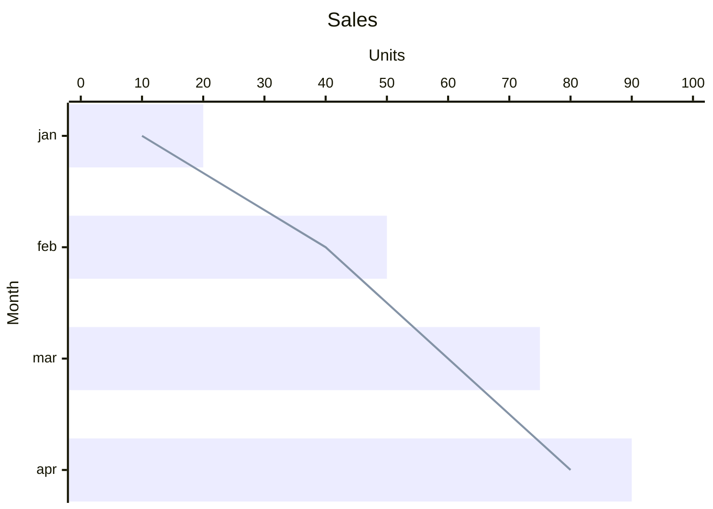
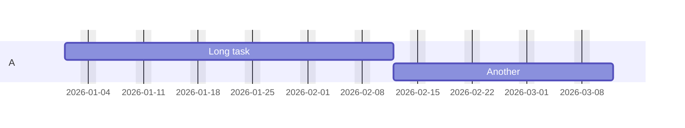
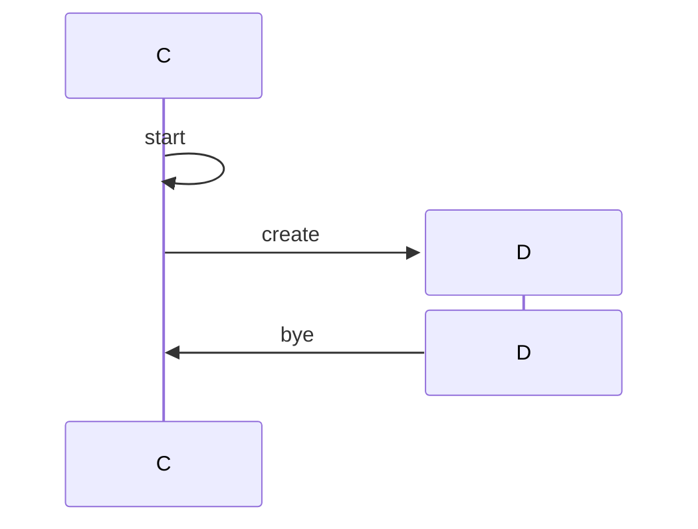
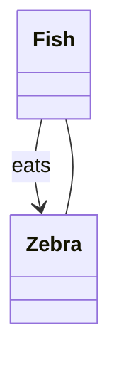
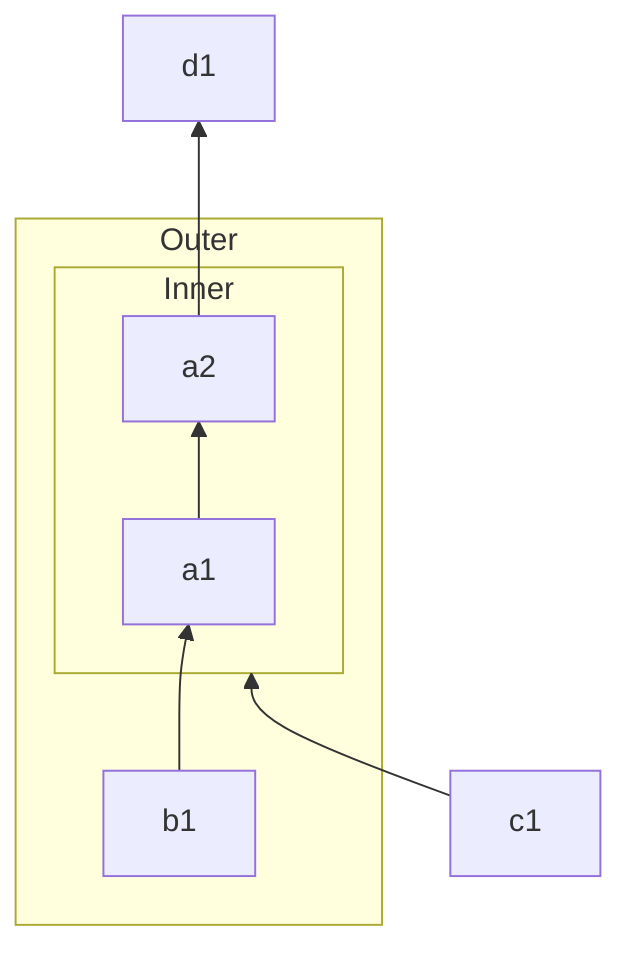
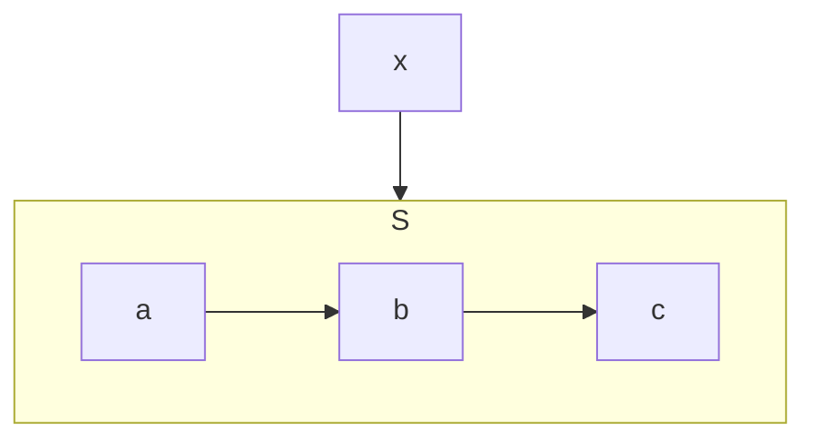
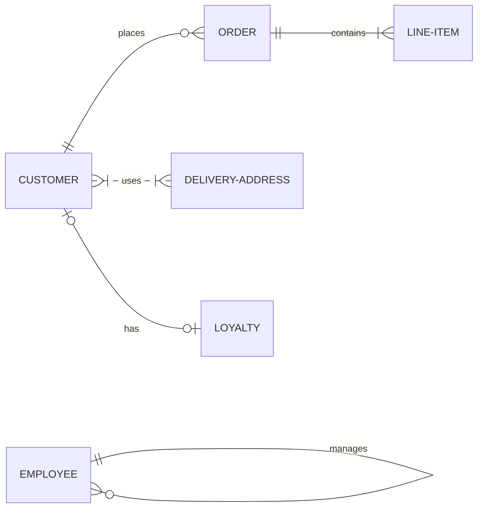
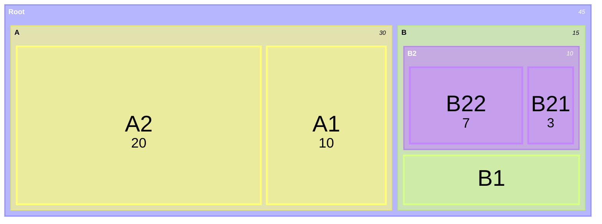
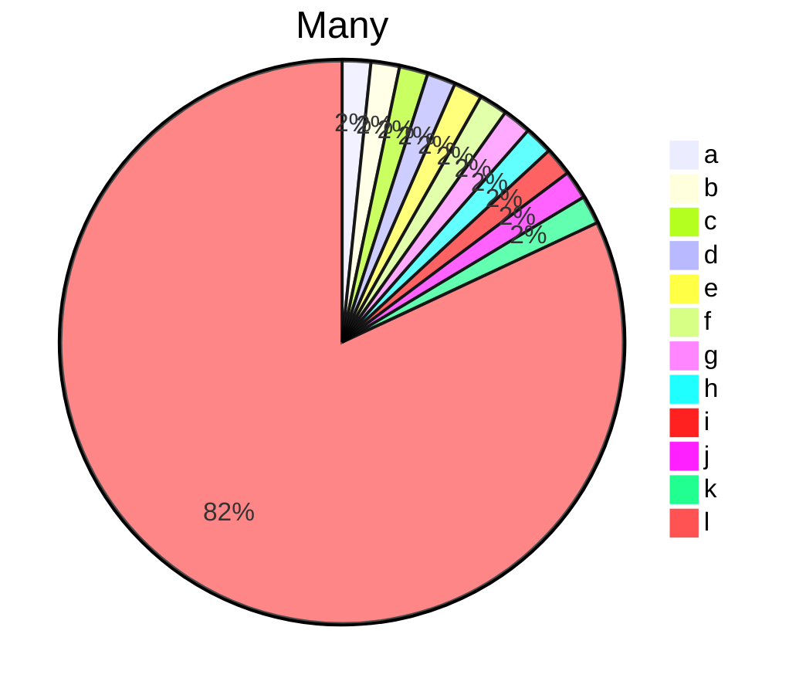
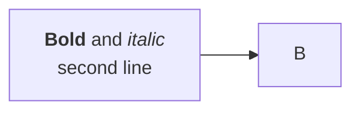

# Mermaid 渲染问题清单与改进计划

> 本文档记录对提交 `0b79107 feat: support pure-Rust Mermaid diagram rendering (13 diagram types)` 的一次完整审查结果，用作后续修复的跟踪清单。架构与设计背景见 [mermaid-design.md](./mermaid-design.md)。
>
> - 审查日期：2026-11-21
> - 审查基线：`v2.3.0` + `0b79107`
> - 审查方式：`cargo clippy --features mermaid --all-targets`、`cargo test --features mermaid`、逐张检查 `asset/image/mermaid-*.png` 示例图、约 60 个异常 / 边界输入的探测，以及 16 个覆盖较全语法的复杂用例（通过 `svg_to_png` 光栅化后人工检查）。
> - 当前进展（截至 `11ae027`）：已完成 24/25 项问题修复（`M-01`–`M-06`、`M-08`–`M-25`，仅剩 `M-07` 子图独立 `direction`）以及 4 项近期增强（`E-01`、`E-04`、`E-05`、`E-12`）。

## 目录

- [一、总体结论](#一总体结论)
- [二、优先级定义](#二优先级定义)
- [三、问题总览](#三问题总览)
- [四、P0：渲染结果错误](#四p0渲染结果错误)
- [五、P1：布局与视觉问题](#五p1布局与视觉问题)
- [六、P2：语法覆盖缺口](#六p2语法覆盖缺口)
- [七、P3：代码整洁](#七p3代码整洁)
- [八、已验证表现良好的能力](#八已验证表现良好的能力)
- [九、健壮性探测记录](#九健壮性探测记录)
- [十、建议的修复顺序与回归测试](#十建议的修复顺序与回归测试)
- [十一、功能增强建议](#十一功能增强建议)

---

## 一、总体结论

| 维度 | 结论 |
|---|---|
| 编译 / 测试 | `tests/mermaid.rs` 15 个用例全部通过；`--no-default-features` 编译通过 |
| Clippy | 1 处 lib 警告（`needless_range_loop`）和 1 处测试的未使用导入 |
| 健壮性 | 约 60 个异常输入**没有 panic，SVG 中没有 `NaN` / `inf`，也没有未转义的 `<` / `&`**；错误都带行号 |
| 性能 | 400 节点 + 57 条回边的 flowchart 在 debug 构建下约 64 ms（SVG 约 500 KB）；500 条消息、20 个参与者的 sequence 约 5 ms |
| 主要风险 | 少数**语义层面渲染错误**（xychart horizontal、sankey 环、gantt excludes、sequence create/destroy、class 多重边），以及若干**布局拥挤 / 遮挡**问题 |

---

## 二、优先级定义

| 级别 | 含义 |
|---|---|
| **P0** | 输出结果与 Mermaid 语义不一致，或图形明显错误 / 不可读，应尽快修复 |
| **P1** | 结果正确，但存在遮挡、重叠、留白或与 Mermaid 视觉习惯明显不一致的问题 |
| **P2** | Mermaid 支持的语法未实现：会报错，或被静默忽略 |
| **P3** | 代码质量问题，不影响输出 |

---

## 三、问题总览

| ID | 级别 | 图表 | 标题 | 状态 |
|---|---|---|---|---|
| [M-01](#m-01-xychart-horizontal-模式下-line-系列被画成柱状) | P0 | xychart | horizontal 模式下 line 系列被画成柱状 | 已完成 (`6c0ceba`) |
| [M-02](#m-02-sankey-存在环时布局完全崩坏) | P0 | sankey | 存在环时布局完全崩坏 | 已完成 (`cf55879`) |
| [M-03](#m-03-gantt-excludes--includes--weekday--tickinterval-被静默忽略) | P0 | gantt | `excludes` / `includes` / `weekday` / `tickInterval` 被静默忽略 | 已完成 (`0149018`) |
| [M-04](#m-04-sequence-的-create--destroy-语义不正确) | P0 | sequence | `create` / `destroy` 语义不正确 | 已完成 (`5576dc8`) |
| [M-05](#m-05-class-同一对类之间的多条关系完全重叠) | P0 | class | 同一对类之间的多条关系完全重叠 | 已完成 (`d959002`) |
| [M-06](#m-06-flowchart-子图外节点压在子图边框上连线穿过子图标题) | P1 | flowchart | 子图外节点压在子图边框上，连线穿过子图标题 | 已完成 (`f5ee2b8`) |
| [M-07](#m-07-flowchart-子图内-direction-被忽略) | P1 | flowchart | 子图内 `direction` 被忽略 | 待处理 |
| [M-08](#m-08-er-图-lr-方向下拥挤自环渲染不完整) | P1 | er | LR 方向下拥挤，自环渲染不完整 | 已完成 (`b347530`) |
| [M-09](#m-09-treemap-缺少分组标题与分组边框) | P1 | treemap | 缺少分组（section）标题与边框 | 已完成 (`d650749`) |
| [M-10](#m-10-xychart-自动图例与数值型-x-轴) | P1 | xychart | 自动图例 `Bar 1` / `Line 1`，数值型 x 轴被当作类目 | 已完成 (`d6cad77`) |
| [M-11](#m-11-pie-小扇区标签互相重叠) | P1 | pie | 小扇区标签互相重叠 | 已完成 (`f8fd383`) |
| [M-12](#m-12-sankey-画布无内边距节点排序导致交叉) | P1 | sankey | 画布无内边距，节点排序导致不必要的交叉 | 已完成 (`6d735a3`) |
| [M-13](#m-13-radar-图形整体偏上) | P1 | radar | 图形整体偏上，底部留白过多 | 已完成 (`536609f`) |
| [M-14](#m-14-gantt-active--done-的视觉表达与-mermaid-不一致) | P1 | gantt | `active` / `done` 的视觉表达与 Mermaid 不一致 | 已完成 (`529e7e8`) |
| [M-15](#m-15-class-抽象成员未使用斜体静态成员下划线偏长) | P1 | class | 抽象成员未使用斜体，静态成员下划线偏长 | 已完成 (`c3f1021`) |
| [M-16](#m-16-sequence-组合片段始终横跨全部参与者) | P1 | sequence | 组合片段（loop/alt/par…）始终横跨全部参与者 | 已完成 (`7c926c0`) |
| [M-17](#m-17-flowchart-不支持-markdown-字符串) | P2 | flowchart | 不支持 Markdown 字符串 `` "`...`" `` | 已完成 (`8267a4b`) |
| [M-18](#m-18-flowchart-不支持-v11-的--shape-语法) | P2 | flowchart | 不支持 v11 `A@{ shape: ... }` 语法 | 已完成 (`345dd9e`) |
| [M-19](#m-19-flowchart-不处理-fafa-xxx-图标前缀) | P2 | flowchart | 不处理 `fa:fa-xxx` 图标前缀 | 已完成 (`26e1070`) |
| [M-20](#m-20-gantt-不支持-vert-任务) | P2 | gantt | 不支持 `vert` 任务 | 已完成 (`ef458af`) |
| [M-21](#m-21-flowchart---x-端点标记过小) | P2 | flowchart | `--x` 端点标记过小 | 已完成 (`26e1070`) |
| [M-22](#m-22-mindmap-markdown-只去除粗体标记不渲染样式) | P2 | mindmap | Markdown 只去除 `**` / `__`，不渲染样式 | 已完成 (`8267a4b`) |
| [M-23](#m-23-clippy-与测试警告) | P3 | — | Clippy 与测试警告 | 已完成 (`34912e7`) |
| [M-24](#m-24-has_custom_background-的冗余参数) | P3 | — | `has_custom_background` 的冗余参数 | 已完成 (`34912e7`) |
| [M-25](#m-25-mermaidchartfrom_json-与-draw_header-的重复代码) | P3 | — | `from_json` 与 `draw_header` 的重复代码 | 已完成 (`38003fb`) |

---

## 四、P0：渲染结果错误

### M-01 xychart horizontal 模式下 line 系列被画成柱状

**现象**：`xychart-beta horizontal` 中的 `line [...]` 系列被画成了横向柱子，和 `bar` 系列并排，看不出折线。

**复现**：



**期望（Mermaid 行为）**：横向模式下 bar 画成横向柱，line 画成纵向延伸的折线（点位于各类目的中心）。

**根因**：[xychart.rs](../src/charts/mermaid/adapters/xychart.rs#L245-L267) 在 `horizontal == true` 时把整个 `series_list` 交给 `HorizontalBarChart`。`HorizontalBarChart` 不支持 `SeriesCategory::Line`，所有系列都按柱处理。

**修复建议**：
1. 首选：让 `HorizontalBarChart` 支持 `SeriesCategory::Line`，在类目中心按数值画折线和点。这同时增强了主库能力。
2. 备选：在 Mermaid 适配层自行绘制，即先用 `HorizontalBarChart` 渲染柱，再根据同一坐标系把 line 叠加成 path。这需要拿到绘图区几何信息，耦合较高。
3. 最低限度：在实现之前，horizontal 模式下遇到 `line` 时返回明确的 `Error::Mermaid`，不要输出错误的图形。

**验收**：上例中 line 系列显示为折线；新增快照 `asset/mermaid_chart/xychart_horizontal_json.svg`。

---

### M-02 sankey 存在环时布局完全崩坏

**现象**：输入中有环时，所有节点挤到画布最右侧，宽度接近 0，连线叠在一起，左侧 80% 的画布是空白。

**复现**：

```mermaid
sankey-beta
A,B,10
B,C,5
C,A,2
B,D,5
```

**期望（Mermaid 行为）**：Mermaid（d3-sankey）遇到环会直接抛出 `circular link` 错误，不会渲染。

**根因**：[sankey.rs](../src/charts/mermaid/adapters/sankey.rs#L74-L130) 只校验了列数、空值和负值，没有做环检测。主库 [`SankeyChart::layout`](../src/charts/sankey_chart.rs#L261) 的列分配（按最长路径计算深度）假设输入是 DAG；有环时深度计算失效，所有节点被分到同一列或最后一列。

**修复建议**：
1. 在 Mermaid 适配层做 DFS 环检测（三色标记），检测到环时返回：
   `Error::Mermaid { line: Some(<产生回边的那一行>), message: "sankey diagram contains a circular link `C -> A`" }`。
2. 同时建议在主库 `SankeyChart` 中增加防御：有环时 `layout` 返回 `None` 或报错，避免 JSON 入口出现同样的崩坏。
3. 自环（`A,A,5`）也应作为环报错。

**验收**：上例返回带行号（第 4 行，即 `C,A,2`）的错误；新增单元测试。

---

### M-03 gantt `excludes` / `includes` / `weekday` / `tickInterval` 被静默忽略

**现象**：`excludes weekends` 没有任何效果，`30d` 的任务仍按 30 个自然日计算，任务结束日期和依赖链的位置全部偏移。

**复现**：



**期望（Mermaid 行为）**：
- `excludes weekends`：工期按工作日顺延（30 个工作日约 6 周），并以浅色背景标出被排除的日期。
- `excludes 2026-01-05, sunday`：支持具体日期和星期名。
- `includes`：在被排除的日期中再排除一部分，即强制计入工期。
- `weekday monday`：设置周起始，影响 `excludes weekends` 和周刻度。
- `tickInterval 1week`：控制刻度间隔。

**根因**：[gantt.rs](../src/charts/mermaid/adapters/gantt.rs#L416-L424) 把 `excludes`、`includes`、`tickinterval`、`weekday`、`click` 统一 `continue` 掉了。

**修复建议**：
1. 解析 `excludes` 得到排除集合（`weekends`、星期名、具体日期），解析 `includes` 得到例外集合。
2. 在 `resolve_task` 中计算 `Nd` 工期时逐日推进，跳过被排除的日期。Mermaid 的规则是：起始日落在排除日时顺延；`after` 依赖的起点同样适用。
3. 渲染时在被排除的日期区间画浅色竖条（需要 `GanttChart` 支持背景区间，或在适配层叠加）。
4. `tickInterval` 映射到 `GanttChart` 的刻度间隔配置（如果主库不支持，需要先扩展）。
5. 短期内若无法完成，至少应在文档中说明这些指令目前被忽略。

**验收**：上例中 `Long task` 结束于 2026-02-11，`Another` 从 2026-02-12 开始，并顺延 20 个工作日。

---

### M-04 sequence 的 `create` / `destroy` 语义不正确

**现象**：
1. `create participant D` 创建的参与者头部仍画在图的顶部，生命线从顶部开始。
2. `destroy D` 的 ✕ 画在**下一条消息之前**，但在 Mermaid 中，`destroy X` 后面紧跟的消息才是"销毁消息"，✕ 应画在这条消息的末端。
3. 被销毁的参与者底部仍然画了 footer（参与者名称框）。

**复现**：



**期望（Mermaid 行为）**：
- D 的头部框出现在 `C->>D: create` 这条消息的 y 位置，消息箭头指向 D 的头部框。
- `D->>C: bye` 正常绘制，✕ 位于 D 生命线上这条消息所在的高度，生命线在此结束。
- D 没有 footer。

**根因**：
- [sequence.rs:431-438](../src/charts/mermaid/sequence.rs#L431-L438) 只是把 `create` 前缀去掉，然后当作普通声明处理，没有记录"创建于第 N 个事件"。
- [sequence.rs:465-471](../src/charts/mermaid/sequence.rs#L465-L471) 在遇到 `destroy` 的那一行立刻推入 `SeqEvent::Destroy`。[sequence.rs:1100-1108](../src/charts/mermaid/sequence.rs#L1100-L1108) 随即在当前 y 画 ✕，并占用 14px 高度。
- footer 的绘制没有检查 `destroyed_y`。

**修复建议**：
1. 为 `Participant` 增加 `created_at: Option<usize>`（事件索引）。布局时，若 `created_at` 有值，头部框的 y 取该事件的 y，生命线从头部框底部开始；消息终点改为头部框的左 / 右边缘。
2. `destroy X` 只设置一个 `pending_destroy = Some(X)`，在下一条 `Message` 事件布局完成后，再于该消息的 y 处标记 ✕ 并结束生命线。如果 `destroy` 后面没有任何消息，就在当前 y 处画 ✕。
3. 绘制 footer 时跳过 `destroyed_y.is_some()` 的参与者。
4. 被创建的参与者不画顶部的初始头部框。

**验收**：上例渲染结果与 Mermaid 官方一致；在 `tests/mermaid.rs` 中断言 D 只出现一次头部框，且没有 footer。

---

### M-05 class 同一对类之间的多条关系完全重叠

**现象**：`Fish --> Zebra : eats` 与 `Zebra -- Fish` 两条关系的连线完全重合，只能看到一条线。后画的那条线压在先画的标签 `eats` 上，标签看起来被线贯穿。

**复现**：



**期望（Mermaid 行为）**：同一对节点之间的多条边各自独立，有一定曲率或偏移，标签不被遮挡。

**根因**：Sugiyama 布局（[layout/sugiyama.rs](../src/charts/mermaid/layout/sugiyama.rs)）为每条边独立计算端点和路径，没有处理平行边（同向或反向的同一对节点）。另外，所有边线和标签按"边 → 标签"的顺序交替绘制，后画的边会覆盖先画边的标签。flowchart、state、er 共用这套布局，理论上也存在同样的问题。

**修复建议**：
1. 在布局输出阶段，对无序节点对 `(min(u,v), max(u,v))` 分组。组内有 k 条边时，按 `(i - (k-1)/2) * spacing`（建议 spacing 约 14px）沿边的法向偏移中间控制点，生成彼此分开的曲线。
2. 绘制顺序改成**两遍**：先画所有边线和端点标记，再统一画所有边标签（包括 class 的基数标签和 er 的关系标签）。这样标签永远不会被线覆盖。这一改动对 flowchart / state / er 同样适用，建议在 `draw.rs` 层统一实现。
3. 修复后同时检查 flowchart 中 `A --> B` 和 `B --> A` 同时存在的情况。

**验收**：上例中两条线可以区分，`eats` 标签完整可读；flowchart 的双向边用例同样通过。

---

## 五、P1：布局与视觉问题

### M-06 flowchart 子图外节点压在子图边框上，连线穿过子图标题

**现象**：
1. `c1` 不属于 `Outer` 子图，却和 `Outer` 的右边框重叠。
2. `a2 --> d1` 的连线竖直穿过子图标题 `Inner` 和 `Outer` 的文字。

**复现**：



**根因**：
- 坐标分配（x 方向）阶段只在同一层内处理节点间距，没有把"子图包围盒 + padding"当作障碍物参与外部节点的排布，所以外部节点可能被放进子图的包围盒范围。
- 子图标题区域没有预留出来，也不参与边的避让；在 BT / TB 方向上，跨出子图的边会正好穿过标题。

**修复建议**：
1. 坐标分配完成后，增加"子图包围盒碰撞消解"：对每个子图计算包围盒（含 padding 和标题高度）；对同层中不属于该子图、但落在包围盒 x 区间内的节点，向远离子图中心的方向平移，并级联推动后续节点。
2. 标题位置随方向调整，例如 BT 时把标题放到子图底部；或者把标题水平放在偏左的位置，并让跨越边界的边的出入点避开标题区间。
3. 边端点连接到子图时（`c1 --> Inner`），箭头应停在子图边框上（目前大体正确，但需确认 BT 方向的行为）。

**验收**：上例中 `c1` 完全位于 `Outer` 之外，标题文字不被任何边穿过。

---

### M-07 flowchart 子图内 `direction` 被忽略

**现象**：在子图内写 `direction LR` 没有效果，子图内仍沿用全局方向。

**复现**：



**根因**：[flowchart.rs:848-860](../src/charts/mermaid/flowchart.rs#L848-L860) 只在 `sg_stack.is_empty()` 时才应用 `direction`，子图内的方向被解析后直接丢弃。

**修复建议**：
1. 在子图结构中记录 `direction: Option<Direction>`。
2. 布局时，对设置了方向、并且**没有边跨越子图边界连到内部节点**的子图（Mermaid 本身的限制也是这样：有外部边连到内部节点时，子图方向会被忽略），先递归地独立布局子图，再把它当作一个大节点参与外层布局（复合图布局）。
3. 实现前先在文档中注明该限制。

**验收**：上例中 a、b、c 水平排列，整个子图作为一个块位于 `x` 下方。

---

### M-08 ER 图 LR 方向下拥挤，自环渲染不完整

**现象**：
1. `EMPLOYEE ||--o{ EMPLOYEE : manages` 自环的端点基数标记（`||` / `o{`）被截断，只露出一半。
2. `has` 和 `manages` 两个标签上下挤在一起。`CUSTOMER → LOYALTY` 的连线从 EMPLOYEE 自环附近穿过。
3. 同一 rank 的实体在 LR 方向下纵向间距不足。

**复现**：



**根因**：
- 自环路径（[er.rs:629](../src/charts/mermaid/er.rs#L629) 附近 `routed.self_loop`）的环半径过小，端点切线方向和实体边框几乎平行，基数标记大部分落在实体框内被覆盖。
- 布局阶段没有为边标签预留空间（标签尺寸没有作为虚拟节点参与 rank 间距计算）。

**修复建议**：
1. 自环画在实体的右上角（LR 时画在上方），出入点分别取边框上相距约 0.5 倍高度的两点，环外扩约 30–40px，保证两端各有至少 20px 的直线段放置基数标记。
2. 参照 dagre 的做法，把带标签的边拆成"边标签虚拟节点"，让标签参与 rank 分配和同层间距计算，从根本上避免标签互相重叠和标签压节点。这对 flowchart / state / class 同样有益。
3. 作为过渡方案，增大 LR 方向下同层节点的最小间距（考虑标签高度）。

**验收**：上例中自环两端的标记完整可见，所有标签互不重叠。

---

### M-09 treemap 缺少分组标题与分组边框

**现象**：有父子层级的 treemap 只渲染叶子矩形，`Compute` / `Storage` / `Networking` 这类分组名不显示，嵌套层级（如 `B → B2 → B21`）完全看不出来。分组之间只能靠颜色深浅大致区分，有时同组颜色也不一致。

**复现**：示例 `asset/mermaid_chart/treemap.json`，或：



**期望（Mermaid 行为）**：每个非叶子节点画成一个带标题栏（约 20–24px 高，显示分组名）和边框的容器，子节点在容器内部排布。

**根因**：[treemap.rs:268-300](../src/charts/mermaid/adapters/treemap.rs#L268-L300) 直接复用主库 `TreemapChart`。`TreemapChart` 只绘制叶子节点，没有分组标题和容器边框。

**修复建议**：
1. 在主库 `TreemapChart` 中增加可选的分组头部支持（如 `show_group_header: bool`、`group_header_height: f32`）：布局时先为非叶子节点扣除头部高度，再在剩余区域递归 squarify，并绘制分组的边框和标题。
2. Mermaid 适配层默认开启该选项。
3. 同一顶层分组内的叶子使用同一色系（例如按顶层分组取 palette 颜色，深层级逐级调浅），与 Mermaid 的风格保持一致。

**验收**：上例能看到 Root / A / B / B2 四层容器及其标题。

---

### M-10 xychart 自动图例与数值型 x 轴

**现象**：
1. 自动生成的图例 `Bar 1` / `Line 1` 没有业务含义，Mermaid 也不显示这个图例。
2. `x-axis 1 --> 10` 与 5 个数据点组合时，x 轴标签变成 `1, 3.2, 5.5, 7.8, 10`，出现不整齐的小数刻度。

**根因**：
- 系列名在 [xychart.rs:191](../src/charts/mermaid/adapters/xychart.rs#L191) 和 [xychart.rs:204](../src/charts/mermaid/adapters/xychart.rs#L204) 被设为 `Bar {n}` / `Line {n}`，并且 legend 默认显示。
- 数值型 x 轴在 [xychart.rs:225-243](../src/charts/mermaid/adapters/xychart.rs#L225-L243) 中按 `(max-min)/(len-1)` 等分后生成类目字符串，仍按类目轴处理。

**修复建议**：
1. Mermaid 适配层默认 `legend.show = Some(false)`，与 Mermaid 保持一致。如果需要，可以通过 frontmatter 的 `config.xyChart.showLegend` 之类的开关打开。
2. 数值型 x 轴的处理二选一：
   - 生成"整洁刻度"（nice ticks，例如 1、3、5、7、9 加上 10），数据点按真实数值映射位置（需要主库支持数值 x 轴，或改用 `ScatterChart` / `LineChart` 的数值轴）；
   - 至少把标签格式统一为整数或固定小数位，并在刻度不整齐时只显示首尾。
3. 补充 x 轴标题（`x-axis "title" 1 --> 10` 已解析，需确认非 horizontal 模式下能正常显示）。

**验收**：gallery 中的 `mermaid-xychart.png` 不再出现 `Bar 1` / `Line 1` 图例；数值轴不出现 3.2 这类刻度。

---

### M-11 pie 小扇区标签互相重叠

**现象**：有多个小扇区（如 11 个 1.6% 加 1 个 82%）时，b/c/d/e 等外部标签相互覆盖，无法阅读。顶部图例也很拥挤。

**复现**：



**根因**：主库 `PieChart` 的外部标签按扇区中心角放置，左右两侧没有做纵向避让（label collision avoidance）。

**修复建议**：
1. 在主库 `PieChart` 中实现常见的"两侧分列 + 纵向避让"算法：标签按左右半圆分组，按 y 排序，相邻标签间距小于行高时依次下推（必要时上推），引导线随之弯折。
2. 扇区角度小于阈值（如 3°）时不画外部标签，只保留在图例中。
3. 对 Mermaid 场景，可以考虑把图例放在右侧纵向排列（Mermaid 的默认样式）。

**验收**：上例中所有标签互不重叠。

---

### M-12 sankey 画布无内边距，节点排序导致交叉

**现象**：
1. gallery `mermaid-sankey.png` 中最底部的 `Transport` 节点紧贴画布底边，最左列节点紧贴左边。
2. `Gas → Heat` 的连线从左上一路斜穿到右下，和 Solar / Wind 的连线大面积交叉。

**根因**：
- 主库 `SankeyChart` 的绘图区默认没有内边距，或 Mermaid 适配层没有设置 `margin`。
- 同列节点按输入顺序排列，[`relax`](../src/charts/sankey_chart.rs#L772) 迭代次数或权重不足以消除交叉。

**修复建议**：
1. Mermaid 适配层在 `apply_base_options` 中设置一个默认 margin（例如 `{ left: 10, top: 10, right: 10, bottom: 10 }`）。
2. 在主库中增加按"相邻列加权重心"排序同列节点的步骤（类似 Sugiyama 的 barycenter 迭代），然后再做 relax / 碰撞消解。

**验收**：gallery 图中各节点与画布边缘至少留 8px；`Gas` 节点排到 `Heat` 对应的一侧，交叉明显减少。

---

### M-13 radar 图形整体偏上

**现象**：gallery `mermaid-radar.png` 中雷达图主体偏上，底部留白约是顶部的 2 倍。

**根因**：主库 `RadarChart` 在计算圆心时，考虑了标题和图例占用的顶部空间，但正多边形（尤其是五边形）的视觉中心和外接圆圆心不重合，底部顶点的 y 值小于半径，导致底部空白偏多。

**修复建议**：按多边形各顶点（含轴标签尺寸）的实际包围盒，而不是外接圆，来垂直居中；或者在奇数轴数时对圆心做 `r * (1 - cos(π/n)) / 2` 的下移补偿。

**验收**：五轴雷达图上下留白差值在 10px 以内。

---

### M-14 gantt `active` / `done` 的视觉表达与 Mermaid 不一致

**现象**：
1. `active` 任务显示为"左半实色、右半浅色"，像是 50% 进度条，容易误解为完成了一半。
2. `done` 任务和普通任务颜色相同（progress = 1.0 画满实色）。Mermaid 中 done 是灰色，以便区分已完成和未开始。

**根因**：[gantt.rs:505-511](../src/charts/mermaid/adapters/gantt.rs#L505-L511) 把 `done` 映射成 `progress = 1.0`，把 `active` 映射成 `progress = 0.5`。

**修复建议**：
1. 不再借用 `progress` 字段：`done` 使用灰色系（如 theme 的 axis / grid 颜色混合），`active` 使用带描边的高亮色或较浅的同色系，`crit` 使用红色描边（Mermaid 的 crit 是红色边框加红色填充）。
2. 状态组合（`crit, done`、`crit, active`）按 Mermaid 的规则叠加：crit 决定边框，done / active 决定填充。
3. 可选：在 legend 中增加状态图例，或保持按 section 着色，并在 section 色基础上做状态变体。

**验收**：gallery `mermaid-gantt.png` 中 `Architecture RFC` / `API Review`（done）显示为灰色，`Core Engine`（active）为整条高亮，没有半截效果。

---

### M-15 class 抽象成员未使用斜体，静态成员下划线偏长

**现象**：
1. `+area()* double` 这类抽象成员只是颜色略有变化，没有用斜体。UML 规范和 Mermaid 都用斜体表示抽象。
2. 静态成员 `+create()$ Order` 的下划线比文字略长（gallery `mermaid-class.png`）。

**根因**：[class.rs:1260-1288](../src/charts/mermaid/class.rs#L1260-L1288)：
- 抽象成员只通过 `mix_color(text_color, palette.accent, 0.38)` 改颜色；`draw_multiline_text` 没有字体样式参数。
- 下划线宽度用的是 `ft.width * 0.96`。`ft.width` 是含内部 padding 的格式化宽度，不是纯文字宽度，而且测量字体与实际渲染字体（PNG 中的 Roboto / 系统字体）存在差异。

**修复建议**：
1. 给 `draw_multiline_text`（或 `Text` 组件）加上 `font_style: Option<String>`，抽象成员输出 `font-style="italic"`；颜色可以保持不变，或者只是略微淡化。
2. 下划线改为基于 `measure_text_width_family` 对单行纯文本的精确宽度，并且只给成员名称部分画线（Mermaid 对整行画线也可以接受）；去掉 0.96 这个经验系数。
3. 可选：输出 `text-decoration="underline"` 作为语义补充（resvg 支持该属性）。

**验收**：SVG 中抽象成员带 `font-style="italic"`；下划线与文字左右对齐（误差不超过 1px）。

---

### M-16 sequence 组合片段始终横跨全部参与者

**现象**：`loop` / `alt` / `par` / `critical` / `break` / `opt` / `rect` 的框都从最左侧画到最右侧，即使其中只有 Alice 和 Bob 之间的消息。gallery 的 `mermaid-sequence.png` 中，`alt` 框的左边界还越过了 `box Edge` 分组框，两者边框交错。

**期望（Mermaid 行为）**：片段框的水平范围只覆盖片段内消息 / note 实际涉及的参与者，左右各留一定 padding；嵌套片段逐层内缩。

**修复建议**：
1. 在布局阶段为每个片段收集其内部事件涉及的参与者索引集合，取 `min_col` / `max_col`，框的 x 范围为 `[col_x[min] - pad - depth*inset, col_x[max] + pad + depth*inset]`。
2. 片段内的 note（`left of` / `right of`）需要把 note 的宽度也算进范围。
3. 片段标签（`[Payment OK]`）的宽度若超过框宽，应相应扩大框宽。

**验收**：gallery 示例中 `alt` 框从 Web 附近开始，不再与 `Edge` 分组框交错。

---

## 六、P2：语法覆盖缺口

### M-17 flowchart 不支持 Markdown 字符串

**现象**：
1. `` A["`**Bold** and _italic_`"] `` 把反引号、`**`、`_` 原样显示出来。
2. 在 Markdown 字符串中直接换行（真实换行符）会报错：`unclosed node shape delimiter`。

**复现**：



**期望（Mermaid 行为）**：Markdown 字符串支持 `**粗体**`、`*斜体*` / `_斜体_`，自动换行，并允许字符串内包含真实换行。

**根因**：
- [text.rs](../src/charts/mermaid/text.rs) 的 `format_and_measure` 只处理 `<br>`、实体和 HTML 标签，不识别 Markdown 字符串。
- 预处理 / 行分割在引号内部仍按物理行切分，导致跨行字符串被截断。
- mindmap 有自己的 `strip_markdown_quotes`（[mindmap.rs:73](../src/charts/mermaid/mindmap.rs#L73)），但没有提取成公共函数。

**修复建议**：
1. 在 `text.rs` 中实现公共的 `parse_markdown_label(raw) -> Vec<Vec<Span { text, bold, italic }>>`，并让 `FormattedText` 支持按 span 分段输出 `<tspan font-weight="bold">` / `<tspan font-style="italic">`；测量时按 span 分别计算宽度（粗体用加宽系数或粗体字形）。
2. 在 `preprocess` 中支持"引号内不切行"：遇到未闭合的 `"`` ` 时把后续物理行拼接进来，并保留原始行号用于报错。
3. flowchart、mindmap、state、class 的标签统一使用该公共函数。

**验收**：上例中 Bold 显示为粗体，italic 为斜体，标签为两行。

---

### M-18 flowchart 不支持 v11 的 `@{ shape }` 语法

**现象**：`A@{ shape: doc, label: "Doc" } --> B` 会报 `unexpected syntax in flowchart`。

**期望（Mermaid v11.3+）**：支持 `id@{ shape: <name>, label: "...", ... }` 扩展语法，内置约 30 种形状（`rect`、`rounded`、`stadium`、`subproc`、`cyl`、`circle`、`diam`、`hex`、`lean-r`、`lean-l`、`trap-b`、`trap-t`、`dbl-circ`、`doc`、`docs`、`delay`、`h-cyl`、`lin-cyl`、`curv-trap`、`div-rect`、`tri`、`win-pane`、`f-circ`、`fr-rect`、`notch-rect`、`bolt`、`hourglass`、`brace`、`brace-r`、`braces`、`flag`、`odd`、`sm-circ`、`cross-circ`、`bow-rect`、`lin-rect`、`tag-rect`、`tag-doc`、`notch-pent`、`st-rect`、`text` 等），以及语义别名（`process`、`decision`、`database`、`document`、`event` 等）。

**修复建议**：
1. 节点解析中识别 `@{ ... }`，用简单的 YAML-like 键值解析器处理 `shape`、`label`，忽略 `icon` / `img` / `pos` 等暂不支持的键。
2. 先把已有的 13 种形状映射到对应名称和别名；新增形状按使用频率分批实现（建议首批：`doc`、`docs`、`delay`、`lin-cyl`、`h-cyl`、`tri`、`flag`、`sm-circ`、`f-circ`、`text`）。
3. 未知 shape 返回带行号的错误，并列出支持的形状名称。

**验收**：首批形状均有快照测试。

---

### M-19 flowchart 不处理 `fa:fa-xxx` 图标前缀

**现象**：`D["fa:fa-car Car"]` 显示为原样文字 `fa:fa-car Car`。

**修复建议**：在纯 Rust、零依赖的前提下无法渲染 Font Awesome 图标，建议去掉 `fa:fa-xxx`、`fab:fa-xxx`、`fas:fa-xxx` 等前缀 token，只保留文字；在文档中说明图标不支持。mindmap 的 `::icon()` 已经是同样的策略。

**验收**：上例显示为 `Car`。

---

### M-20 gantt 不支持 `vert` 任务

**现象**：`vert :vert, v1, 2026-02-01, 0d` 报错 `too many fields in gantt task`。

**期望（Mermaid v11）**：`vert` 标签表示在该日期画一条纵向标记线（类似今日线），并在顶部或底部标注名称。

**修复建议**：在 tag 列表中识别 `vert`，生成垂直参考线（复用 `todayMarker` 的绘制逻辑），不占用任务行。

---

### M-21 flowchart `--x` 端点标记过小

**现象**：`n --x o` 在目标节点边上的 ✕ 只有约 6px，几乎看不清（见 shapes 用例）。

**根因**：[draw.rs:569-588](../src/charts/mermaid/draw.rs#L569-L588) 中 `size = 4.5`，两条对角线的半长只有 `size * 0.7 * √2 ≈ 4.5px`。

**修复建议**：把 `size` 调到 7–8，半长约 7px（Mermaid 中 cross marker 约 11px 宽），并确保中心点落在节点边框外侧约 `size` 的位置，不被节点覆盖。

---

### M-22 mindmap Markdown 只去除粗体标记，不渲染样式

**现象**：`` "`Zero **External** Deps`" `` 渲染为 `Zero External Deps`，粗体样式丢失；`*italic*` / `_italic_` 的标记则原样保留。

**根因**：[mindmap.rs:73-79](../src/charts/mermaid/mindmap.rs#L73-L79) 只做了 `.replace("**", "").replace("__", "")`。

**修复建议**：与 [M-17](#m-17-flowchart-不支持-markdown-字符串) 统一，改用公共的 Markdown span 解析和渲染。

---

## 七、P3：代码整洁

### M-23 Clippy 与测试警告

```text
warning: the loop variable `idx` is used to index `q.quadrants`
   --> src/charts/mermaid/quadrant.rs:230:20
warning: unused import: `Error`
 --> tests/mermaid.rs:5:34
```

**修复**：
- [quadrant.rs:230](../src/charts/mermaid/quadrant.rs#L230)：改为 `for (idx, slot) in q.quadrants.iter_mut().enumerate()`。
- [tests/mermaid.rs:5](../tests/mermaid.rs#L5)：删除未使用的 `Error` 导入。
- 建议在 CI 中对 `--features mermaid` 也执行 `cargo clippy -- -D warnings`。

### M-24 `has_custom_background` 的冗余参数

[mod.rs:276-289](../src/charts/mermaid/mod.rs#L276-L289) 中 `theme: &Theme` 参数未使用（`let _ = theme;`）。建议删除该参数并同步修改所有调用方；或者真正用它来比较，替代函数内部重新 `get_theme` 的逻辑。

### M-25 `MermaidChart::from_json` 与 `draw_header` 的重复代码

- [mod.rs:139-181](../src/charts/mermaid/mod.rs#L139-L181)：`title_*` 和 `sub_title_*` 七个字段的解析逻辑完全对称，可以抽成 `fn apply_title_options(value, prefix, &mut TitleOption)`。
- [mod.rs:366-456](../src/charts/mermaid/mod.rs#L366-L456)：`draw_header` 中 title 和 sub_title 两段绘制几乎一样（字号、颜色、字重、行高回退到主题，然后截断、对齐、输出文字），可以抽成 `fn draw_title_row(...) -> f32`（返回占用高度）。
- [mod.rs:315-342](../src/charts/mermaid/mod.rs#L315-L342)：`compute_header_height` 与 `draw_header` 的行高计算重复，抽出共用函数后可以保证两者始终一致。
- 主库其他图表的 `from_json` 很可能已有类似的标题解析 helper（见 `params.rs` / `base.rs`），应优先复用。

---

## 八、已验证表现良好的能力

以下能力在本次审查中渲染正确，修复上述问题时需要保持（建议作为回归基线）：

- **flowchart**：13 种基础形状（rect、round、stadium、subroutine、cylinder、circle、asymmetric、rhombus、hexagon、parallelogram 及其反向形式、trapezoid 及其反向形式、double circle），`---` / `-.->` / `==>` / `~~~` / `--o` / `<-->` 各类连线，自环，回边，长边 `---->`，`A & B --> C & D` 链式写法，`style` / `classDef` / `class` / `linkStyle`，嵌套子图，`<br>` 多行，HTML 实体，`#quot;`，CJK 与 emoji。
- **sequence**：actor / participant、`as` 别名、`box` 分组（含 rgba 背景）、autonumber、激活条（`+` / `-` 与 `activate`）、同步 / 异步 / 虚线 / 交叉箭头、自调用、`loop` / `alt-else` / `par-and` / `critical-option` / `break` / `rect`，以及 left / right / over 三类 note。
- **state**：起止状态、choice / fork / join、复合状态、并发区域（`--`）、`state "desc" as X`、`X: description`、单行 / 多行 note、`classDef`、`direction LR`。
- **class**：所有 UML 关系符号、基数标签、泛型 `~T~`、`<<interface>>` 等注解、`namespace`、`note for`、`direction`。
- **er**：所有基数符号（`||`、`|o`、`}|`、`}o`）、实线 / 虚线、属性的 PK / FK / UK 与注释、实体别名 `A["Alias"]`。
- **mindmap**：全部 6 种节点形状、`:::class`、`classDef`、`::icon` 忽略、`<br/>` 多行、左右平衡布局。
- **quadrant**、**radar**（polygon / circle 网格、按 key 指定值）、**pie**（`showData`）、**gantt**（`after` 依赖、`axisFormat`、`crit`、milestone、section 着色）。
- **公共能力**：frontmatter（`title`、`config.theme`）、`%%{init}%%` 主题、`%%` 注释、CRLF、Tab 缩进；`width` / `height` 按比例缩放 `viewBox`；`MultiChart` 集成。

---

## 九、健壮性探测记录

以下输入均返回带行号的 `Error::Mermaid` 或正常渲染，**没有任何 panic**，耗时都在 1 ms 左右（debug 构建）：

| 类别 | 输入 | 结果 |
|---|---|---|
| 空图 | `flowchart`、`graph TD`、`sequenceDiagram`、`stateDiagram-v2`、`classDiagram`、`erDiagram`、`mindmap`、`pie`、`gantt`、`sankey-beta`、`xychart-beta`、`treemap-beta` | 报错：`... has no nodes / entries` |
| 空图 | `quadrantChart` | 渲染空象限（与 Mermaid 一致） |
| 未闭合块 | `subgraph` 缺 `end`、`loop` 缺 `end`、`state X {` 缺 `}`、`class X {` 缺 `}` | 报错，指向开块所在行 |
| 多余闭合 | 没有对应 `subgraph` 的 `end` | 报错：`unexpected end` |
| 形状错误 | `A[[[x` | 报错：`unclosed node shape delimiter` |
| 转义 | `A["<script>&x</script>"]`、`B[a & b < c]` | 正确转义为 `&lt;` / `&amp;` |
| 依赖错误 | gantt `after zz`（未知 id）、`a after b` + `b after a`（循环） | 报错 |
| 日期 | `2026-13-45` | 报错 |
| 极值 | gantt `99999d` | 正常渲染 |
| 数值 | pie 负值、sankey 负值 | 报错 |
| 数值 | pie 全为 0 | 渲染（**建议**：改为报错或显示占位，见下方备注） |
| 越界 | quadrant `[1.5, -0.2]` | 报错：`must be within 0.0..=1.0` |
| 轴数 | radar 少于 3 个轴 | 报错 |
| 结构 | mindmap 双根 | 报错：`only a single root` |
| 隐式声明 | sequence `Note over Z,Q`（未声明的参与者） | 自动创建参与者（与 Mermaid 一致） |
| 不匹配 | xychart `x-axis [a,b,c]` + `bar [1,2]` | 渲染（**建议**：Mermaid 会按较短者对齐，这里应确认缺失值显示为空，而不是 0） |
| 未知类型 | `foobar` | 报错：`unsupported Mermaid diagram type` |
| 仅注释 | `%% just a comment` | 报错：`empty Mermaid diagram` |
| 规模 | 400 节点 flowchart | 64 ms |
| 规模 | 500 条消息的 sequence | 5 ms |

> **备注**：
> - pie 全为 0 时扇区角度全部为 0，建议返回 `pie diagram has no positive values`，与 treemap 的 `has no positive leaf values` 行为保持一致。
> - `B(['q"uote'])` 这种节点文本中带未配对双引号的情况会报 `unclosed node shape delimiter`，错误信息可以更具体，例如提示引号未闭合。

---

## 十、建议的修复顺序与回归测试

### 10.1 修复批次

| 批次 | 内容 | 说明 |
|---|---|---|
| 第 1 批（低成本，高收益） | M-02、M-10（隐藏图例）、M-14、M-19、M-21、M-23、M-24 | 基本都是适配层的小改动，1 天内可完成 |
| 第 2 批（语义正确性） | M-01、M-03、M-04、M-15 | 部分需要扩展主库（`HorizontalBarChart` 折线、`Text` 的 font-style） |
| 第 3 批（布局质量） | M-05、M-06、M-08（标签虚拟节点）、M-16 | 集中在 `layout/sugiyama.rs` 和 `draw.rs`，建议一起设计"两遍绘制 + 标签虚拟节点" |
| 第 4 批（主库能力增强） | M-09、M-11、M-12、M-13 | 改动主库 `TreemapChart` / `PieChart` / `SankeyChart` / `RadarChart`，也会使非 Mermaid 用户受益，需要同时更新主库快照 |
| 第 5 批（语法扩展） | M-07、M-17、M-18、M-20、M-22、M-25 | 复合图布局和 Markdown span 渲染工作量最大 |

### 10.2 回归测试建议

1. **为每个已修复的问题新增一个最小用例**，放在 `tests/mermaid.rs` 中，按问题 ID 命名（例如 `m01_xychart_horizontal_line_series`），断言关键的 SVG 特征（如出现 `<path` 折线、包含 `font-style="italic"`、不存在 footer 等）。
2. **扩充快照**：在 `asset/mermaid_chart/` 中加入本文各复现用例的 JSON 和 SVG，由 `mermaid_snapshots` 测试统一校验。
3. **PNG 目检**：`tests/image.rs` 的 `generate_mermaid_image` 中加入 horizontal xychart、嵌套 treemap、create/destroy sequence 等图，方便人工对比。
4. **几何断言工具**：可以在测试中增加一个简单的 SVG 解析 helper，提取所有节点矩形和标签矩形，断言"标签之间不相交""非成员节点不落在子图包围盒内"。这样 M-05、M-06、M-08、M-11 能自动化回归。
5. **CI**：添加 `cargo clippy --features mermaid --all-targets -- -D warnings` 和 `cargo test --features mermaid,png`。

---

## 十一、功能增强建议

> 前面各节关注的是"已支持的功能做得对不对"，本节关注"还能多做什么"。编号以 `E-` 开头，与问题编号 `M-` 区分。每项给出价值、现状、方案要点和工作量估计（S ≈ 1 天以内，M ≈ 2–5 天，L ≈ 1–2 周，XL ≈ 2 周以上）。

### 11.1 增强总览

| ID | 方向 | 标题 | 价值 | 工作量 | 状态 |
|---|---|---|---|---|---|
| [E-01](#e-01-配置项透传frontmatter--init) | 配置 | frontmatter / `%%{init}%%` 配置项透传（目前只识别 `theme`） | 高 | M | 已完成 (`579773b`) |
| [E-02](#e-02-themevariables-自定义主题变量) | 配置 | `themeVariables` 自定义主题变量 | 高 | M | 待处理 |
| [E-03](#e-03-svg-语义化结构idclassdata-属性) | 输出 | SVG 语义化结构（id / class / data-* 属性） | 高 | M | 待处理 |
| [E-04](#e-04-可访问性acctitle--accdescr) | 输出 | 可访问性：`accTitle` / `accDescr` 输出为 `<title>` / `<desc>` | 中 | S | 已完成 (`820103e`) |
| [E-05](#e-05-click--链接交互) | 输出 | `click` / 链接，输出为 SVG `<a>` | 中 | S–M | 已完成 (`c76b6a4`, `11ae027`) |
| [E-06](#e-06-markdown-文档批量渲染) | 工具 | Markdown 文档中 ```` ```mermaid ```` 代码块的批量渲染 | 高 | M | 待处理 |
| [E-07](#e-07-命令行工具mmdc-替代) | 工具 | 命令行工具（`mmdc` 的纯 Rust 替代） | 高 | M | 待处理 |
| [E-08](#e-08-wasm--python--nodejs-绑定) | 工具 | WASM / Python / Node.js 绑定 | 中 | L | 待处理 |
| [E-09](#e-09-新增图表类型) | 覆盖 | 新增图表类型（timeline、journey、gitGraph、block、packet、kanban…） | 高 | 每种 M–L | 待处理 |
| [E-10](#e-10-flowchart-高级特性) | 覆盖 | flowchart 高级特性（边 id 与动画、曲线样式、间距配置） | 中 | M | 待处理 |
| [E-11](#e-11-sequence-高级特性) | 覆盖 | sequence 高级特性（`autonumber` 参数、`links`、参与者类型扩展） | 中 | M | 待处理 |
| [E-12](#e-12-诊断与错误体验) | 体验 | 诊断与错误体验（列号、代码片段、"您是否想写…"提示、宽松模式） | 高 | M | 已完成 (`f466e64`) |
| [E-13](#e-13-解析与渲染分离公开-ast--布局结果) | API | 解析与渲染分离：公开 AST / 布局结果 | 中 | L | 待处理 |
| [E-14](#e-14-布局质量提升) | 布局 | 布局质量提升（交叉最小化、正交路由、Brandes-Köpf 坐标） | 高 | L–XL | 待处理 |
| [E-15](#e-15-文本排版增强) | 排版 | 文本排版增强（自动换行宽度、CJK 断行、字体回退、粗体测量） | 中 | M | 待处理 |
| [E-16](#e-16-导出与集成) | 集成 | 导出与集成：字体内嵌、PDF、尺寸缩放策略、与现有图表的 `MultiChart` 排版 | 中 | M | 待处理 |
| [E-17](#e-17-动画) | 视觉 | 动画（复用主库的动画能力） | 低 | M | 待处理 |
| [E-18](#e-18-手绘风格lookhanddrawn) | 视觉 | 手绘风格 `look: handDrawn` | 低 | L | 待处理 |
| [E-19](#e-19-兼容性测试基建) | 质量 | 兼容性测试基建（对照官方 mermaid 用例集、模糊测试、性能基准） | 高 | M | 待处理 |

---

### E-01 配置项透传（frontmatter / init）

**现状**：[preprocess.rs:185-212](../src/charts/mermaid/preprocess.rs#L185-L212) 和 [preprocess.rs:267-301](../src/charts/mermaid/preprocess.rs#L267-L301) 只从 frontmatter 的 `config` 和 `%%{init}%%` 中提取 `theme`，其他配置（如 `flowchart.curve`、`flowchart.nodeSpacing`、`sequence.mirrorActors`、`gantt.barHeight`）都被丢弃。测试用例里甚至写了 `'flowchart': {'curve': 'basis'}`，但该配置没有生效。

**价值**：Mermaid 用户大量依赖这些配置来微调输出；支持它们是"直接粘贴就能用"的关键。

**方案要点**：
1. 预处理阶段把配置解析为 `serde_json::Value`（YAML frontmatter 可以用一个轻量的缩进解析器转换为 JSON，避免引入 `serde_yaml` 依赖），存入 `Prep::config`。
2. 定义 `MermaidConfig` 结构，按图表类型分组，优先支持使用频率最高的配置：

   | 分组 | 配置项 |
   |---|---|
   | 通用 | `theme`、`themeVariables`（见 E-02）、`fontFamily`、`fontSize` |
   | flowchart | `curve`（`basis` / `linear` / `step` / `monotoneX` …）、`nodeSpacing`、`rankSpacing`、`diagramPadding`、`wrappingWidth` |
   | sequence | `mirrorActors`、`showSequenceNumbers`、`actorMargin`、`messageAlign`、`noteAlign`、`wrap`、`width` |
   | gantt | `barHeight`、`barGap`、`topPadding`、`axisFormat`、`tickInterval`、`displayMode: compact` |
   | pie | `textPosition` |
   | xyChart | `width`、`height`、`showDataLabel`、`chartOrientation` |
   | quadrantChart | `chartWidth`、`chartHeight`、`pointRadius` |
   | er / class / state | `layoutDirection`、`nodeSpacing`、`rankSpacing` |

3. 配置的优先级为：Rust API 显式设置 > JSON 入参 > frontmatter / init > 主题默认值。
4. 未知配置项默认忽略；可在严格模式下（E-12）给出警告。

---

### E-02 `themeVariables` 自定义主题变量

**现状**：配色完全由 charts-rs 的 10 套主题派生（[style.rs](../src/charts/mermaid/style.rs)），用户无法单独调整节点填充、边颜色、字体颜色等。

**方案要点**：
1. 支持 Mermaid 常用变量：`primaryColor`、`primaryTextColor`、`primaryBorderColor`、`secondaryColor`、`tertiaryColor`、`lineColor`、`textColor`、`background`、`mainBkg`、`nodeBorder`、`clusterBkg`、`clusterBorder`、`noteBkgColor`、`noteTextColor`、`noteBorderColor`、`edgeLabelBackground`、`fontFamily`、`fontSize`，以及各图表的专用变量（`pie1`…`pie12`、`git0`…`git7`、`cScale0`…`cScale11`、`quadrant1Fill`… 等）。
2. 在 `MermaidPalette` 构建完成后按变量覆盖；未指定的变量按 Mermaid `base` 主题的派生规则计算（例如 `primaryBorderColor` 由 `primaryColor` 加深得到），保证只设置 `primaryColor` 时整体配色依然协调。
3. Rust API 同步提供 `MermaidChart::theme_variables(HashMap<String, String>)`，JSON 入参支持 `theme_variables` 字段，并更新 [schema.rs](../src/charts/schema.rs) 中的 `MERMAID_FIELDS`。
4. 识别 `theme: base`、`default`、`neutral`、`dark`、`forest`，映射到最接近的 charts-rs 主题（目前已部分映射），`base` 时以 `themeVariables` 为准。

---

### E-03 SVG 语义化结构（id / class / data-* 属性）

**现状**：输出的 SVG 是扁平的 `<rect>` / `<path>` / `<text>` 序列，没有分组，也没有任何 id 或 class，宿主应用无法用 CSS 或 JS 定位"某个节点"或"某条边"。

**价值**：
- 网页中可以通过 CSS 实现 hover 高亮、暗色模式切换和打印样式；
- 可以和前端交互（点击节点弹出详情、高亮路径）；
- 便于测试：SVG 快照断言可以按元素查询，而不是做字符串匹配，M-05 / M-06 等问题的几何断言也会简单很多。

**方案要点**：
1. 每个节点输出为 `<g class="node <classDef 名>" id="<prefix>-node-<id>" data-id="<id>">…</g>`，每条边输出为 `<g class="edge" id="<prefix>-edge-<n>" data-from="A" data-to="B">`，子图、标签、note、actor、message 同理。
2. `prefix` 默认根据源码哈希生成，避免页面上存在多张图时 id 冲突；也可以通过 `MermaidChart::id_prefix` 指定。
3. 作为 opt-in 选项（如 `semantic: bool`，默认开启），`compact` 模式下可以关闭，以减小体积。
4. Canvas 目前不支持分组，需要在 [canvas.rs](../src/charts/canvas.rs) 中增加 `group_begin(attrs)` / `group_end()`，或者在 `Component` 中加入 `Group(Vec<Component>, attrs)`。

---

### E-04 可访问性：`accTitle` / `accDescr`

**现状**：各引擎（如 [flowchart.rs:811](../src/charts/mermaid/flowchart.rs#L811)、[class.rs:485](../src/charts/mermaid/class.rs#L485)）解析后直接丢弃 `accTitle` 和 `accDescr`。

**方案要点**：在预处理阶段统一提取 `accTitle: ...`、`accDescr: ...` 以及多行形式 `accDescr { ... }`，输出为 SVG 根元素的 `role="img"`、`aria-labelledby`，以及 `<title id=...>` / `<desc id=...>`。没有 accTitle 时，回退使用图表标题。改动集中、成本很低，同时能提升无障碍合规性（WCAG）。

---

### E-05 `click` / 链接交互

**现状**：flowchart / class / state 中的 `click A "https://..." "tooltip" _blank`，以及 gantt 的 `click`，都被忽略。

**方案要点**：
1. 支持 `click id href "url" "tooltip" target` 及其简写 `click id "url"`，输出为 `<a href="url" target="_blank"><title>tooltip</title>…节点…</a>`。
2. `click id callback` 形式的 JS 回调在纯 SVG 中无法执行，可以输出 `data-callback="name"` 属性，交给宿主绑定（结合 E-03）。
3. sequence 的 `link` / `links` 语法同样输出为 `<a>`。
4. 安全：仅允许 `http`、`https`、`mailto` 和相对路径，拒绝 `javascript:` 协议；提供 `MermaidChart::allow_links(bool)` 开关（类似 Mermaid 的 `securityLevel`），默认开启并做协议白名单过滤。

---

### E-06 Markdown 文档批量渲染

**价值**：最常见的使用场景是"把 README / 文档里的 mermaid 代码块渲染成图片"（静态站点、PDF 导出、GitHub 以外的平台）。

**方案要点**：
1. 新增 `pub fn render_markdown(md: &str, opts: &MarkdownRenderOptions) -> Result<MarkdownRenderOutput>`，扫描 ```` ```mermaid ```` 代码块（支持 `~~~` 围栏和缩进）。
2. 提供两种输出模式：
   - **内联**：把代码块替换为 `<svg>…</svg>` 或 ``；
   - **外置**：把图片写成文件（SVG / PNG），代码块替换为 ``，文件名用内容哈希命名，便于缓存和增量更新。
3. 每个代码块独立报错，错误中带上 Markdown 文件中的绝对行号；可以选择"保留原代码块并插入错误注释"，而不是中断整个渲染。
4. 不需要引入 Markdown 解析依赖：只处理围栏代码块，用一个简单的行状态机即可。

---

### E-07 命令行工具（`mmdc` 替代）

**价值**：官方 `mermaid-cli`（`mmdc`）依赖 Node.js 和 Puppeteer / Chromium，体积数百 MB，在 CI 和容器中很笨重。一个零依赖的单文件 Rust 二进制是非常有吸引力的替代品，也能为本库带来更多曝光。

**方案要点**：
1. 在 workspace 中新增 `charts-rs-cli` crate（或 `[[bin]]` + `cli` feature），提供命令 `charts-rs mermaid`。
2. 参数尽量兼容 `mmdc`：`-i input.mmd`、`-o out.svg|png|jpg|webp|avif`（按扩展名选择格式）、`-t theme`、`-w width`、`-H height`、`-b background`、`-c config.json`、`-s scale`；`-i -` 表示从 stdin 读取。
3. `-i README.md -o out/` 时走 E-06 的 Markdown 批量模式。
4. 支持 `--watch`（可选）和 `--check`（只校验语法，用于 CI 和 pre-commit hook）。
5. 发布预编译二进制，可选提供 Homebrew 公式和 Docker 镜像。

---

### E-08 WASM / Python / Node.js 绑定

**方案要点**：
- **WASM**：`wasm-bindgen` 导出 `mermaidToSvg(source, options)`，可以在浏览器、Deno 和 Cloudflare Workers 中做服务端渲染，没有 DOM 依赖，比 mermaid.js 更适合边缘计算环境。需要先确认字体加载（内嵌的 Roboto）和 `resvg` 在 wasm32 下的体积，WASM 版本可以只提供 SVG 输出。
- **Python**：`pyo3` + `maturin`，提供 `charts_rs.mermaid_to_svg()` / `mermaid_to_png()`，面向 Jupyter、文档工具（MkDocs、Sphinx 插件）和 LLM 应用（大模型经常生成 Mermaid）。
- **Node.js**：`napi-rs`，作为不依赖 Puppeteer 的服务端渲染方案。
- 三种绑定都应复用 E-01 的配置结构，保持参数一致。

---

### E-09 新增图表类型

目前 Mermaid 官方支持、本库尚未支持的图表类型，按"使用频率 / 实现成本"排序：

| 图表 | 关键字 | 使用频率 | 实现思路 | 工作量 |
|---|---|---|---|---|
| Timeline | `timeline` | 高 | 横向时间轴 + section 着色 + 每个时间点下纵向堆叠事件卡片；纯定制绘制，不需要通用布局 | M |
| User Journey | `journey` | 中 | 横向任务列 + 1–5 分的表情 / 分数纵向定位 + 参与者色点 + section 分段 | M |
| Git Graph | `gitGraph` | 高 | 分支泳道 + commit 圆点 + merge / cherry-pick 曲线 + tag 标签；按时间顺序线性布局，不需要通用图布局 | M–L |
| Block Diagram | `block-beta` | 中 | `columns N` 网格布局 + 跨列块 + 嵌套块 + 箭头连线；网格布局比 Sugiyama 简单 | M |
| Packet | `packet-beta` | 低 | 按位宽排布的定宽网格（每行 32 bit），纯计算布局 | S |
| Kanban | `kanban` | 中 | 列 + 卡片 + 元数据（assigned、ticket、priority）；纯网格布局 | S–M |
| Requirement | `requirementDiagram` | 低 | 带固定字段的卡片节点 + 关系边，复用 Sugiyama 和 class 的绘制方式 | M |
| Architecture | `architecture-beta` | 中 | 分组 + 服务图标 + 指定方向的边（`L` / `R` / `T` / `B`）；需要基于约束的布局，并且依赖图标 | L |
| C4 | `C4Context` / `C4Container` / `C4Component` / `C4Dynamic` / `C4Deployment` | 中 | 固定样式的 Person / System / Container 卡片 + 边界框 + 关系；可以复用 flowchart 的子图布局 | L |
| Radar / Treemap | — | — | 已支持 | — |
| ZenUML | `zenuml` | 低 | 语法完全不同，建议不支持 | — |

建议优先实现 **timeline、gitGraph、kanban、packet**：它们使用频率高或实现成本低，而且大多不依赖通用图布局，能快速提升覆盖率。

---

### E-10 flowchart 高级特性

1. **边 id 与 v11 边属性**：`A e1@--> B` 以及 `e1@{ animate: true, curve: linear }`，支持按边设置曲线样式。动画可以输出为 SVG `stroke-dashoffset` 的 CSS 动画（结合 E-17）。
2. **曲线样式**：`curve: basis | linear | step | stepBefore | stepAfter | monotoneX | cardinal | natural`。目前 [draw.rs](../src/charts/mermaid/draw.rs#L377) 的 `build_smooth_edge_path` 是固定的平滑算法，可以抽象成 `CurveKind` 枚举。
3. **间距配置**：`nodeSpacing`、`rankSpacing`、`diagramPadding`（依赖 E-01）。
4. **`classDef default`** 作为全局默认样式，以及 `linkStyle default`。需要确认是否已支持，未支持则补上。
5. **子图样式**：`style SubgraphId fill:...`、`class SubgraphId cls`。
6. **边上的长文本自动换行**：按 `wrappingWidth` 换行（依赖 E-15）。

---

### E-11 sequence 高级特性

1. `autonumber 10 5`（指定起始值和步长），以及 `autonumber off`。
2. `link` / `links`（参与者菜单链接）输出为 `<a>`（依赖 E-05）。
3. v11 参与者类型扩展：`participant A@{ "type": "boundary" | "control" | "entity" | "database" | "collections" | "queue" }`，对应 UML 的边界、控制、实体等图标。
4. `%%{init: {'sequence': {'mirrorActors': false}}}%%` 关闭底部参与者框，以及 `wrap` 自动换行（依赖 E-01）。
5. 消息文本中的 `<br>` 多行，以及长消息自动换行。
6. 半箭头（v11 新增的 `-|\`、`-\\` 等）。

---

### E-12 诊断与错误体验

**现状**：`Error::Mermaid { line, message }` 只有行号。

**方案要点**：
1. 增加 `column: Option<usize>` 和 `snippet: Option<String>`，按 rustc 风格输出：
   ```text
   Mermaid error at line 3, column 9: unclosed node shape delimiter `[[`
     |
   3 |   A --> B[[sub
     |          ^^ opened here
   ```
2. 常见拼写错误给出提示：`sequencediagram`（大小写）→ 建议 `sequenceDiagram`；`flowchart TB` 写成 `flowchart TOP` 时列出合法方向；`-->>` 用在 flowchart 中时提示这是 sequence 的语法。可以用编辑距离匹配关键字表。
3. **宽松模式**（`MermaidChart::lenient(true)`）：遇到无法识别的行时跳过并记录 warning，尽可能渲染其余部分（mermaid.js 的部分图表也是这种行为）。`render_with_diagnostics() -> (svg, Vec<Warning>)` 同时返回警告列表，包括被忽略的配置项和语法（如目前静默忽略的 `excludes`）。
4. 新增 `pub fn mermaid_validate(source) -> Result<(), Vec<Diagnostic>>`，只解析不渲染，供 CLI 的 `--check`、编辑器插件和 LLM 输出校验使用。

---

### E-13 解析与渲染分离：公开 AST / 布局结果

**价值**：
- 用户可以拿到 AST 做二次处理（统计节点数、检查流程完整性、转换为其他格式）；
- 可以复用布局结果自行绘制（例如画到 Canvas / egui / Skia 上），不局限于 SVG；
- LLM 场景：解析出结构后可以做语义校验。

**方案要点**：
1. 每个引擎内部已经是"解析 → 布局 → 绘制"三段式，只需把中间结构整理成公开类型（`mermaid::ast::Flowchart`、`mermaid::layout::FlowchartLayout`）。
2. 公开 `pub fn parse(source) -> Result<Diagram>`（`Diagram` 为枚举），以及 `pub fn layout(&Diagram, &Config) -> Result<Layout>`。
3. 公开类型要标注 `#[non_exhaustive]`，为后续扩展保留兼容性；API 稳定前可以先放在 `mermaid::unstable` 模块下。
4. 反向能力（可选）：`Diagram -> String` 序列化回 Mermaid 源码，用于格式化（pretty-print）和程序化生成图。

---

### E-14 布局质量提升

在 M-05 / M-06 / M-08 的基础上，进一步提升 [layout/sugiyama.rs](../src/charts/mermaid/layout/sugiyama.rs) 的整体质量：

1. **交叉最小化**：确认 barycenter / median 的迭代次数，加入 transpose（相邻交换）启发式；对规模较小的层可以穷举。
2. **坐标分配**：采用 Brandes-Köpf 算法（dagre 的做法），让长边尽量保持竖直、节点对齐更整齐，减少目前偶尔出现的"拐来拐去"的长边。
3. **长边虚拟节点的路由**：跨多层的边经过虚拟节点后再做样条平滑，避免穿过其他节点（目前 TD 回边会大幅绕行）。
4. **正交路由选项**：`curve: step` 时使用正交（直角）路由，适合架构图和电路风格。
5. **边标签虚拟节点**：见 M-08 的修复建议，这是解决标签重叠的根本方法。
6. **大图性能**：400 节点时约 64 ms（debug 构建）。release 下应该没有问题，但交叉最小化是 O(迭代 × 边数)，建议为超过 1000 个节点的图设置迭代上限或超时保护，并加入 benches 基准（见 E-19）。
7. **布局稳定性**：同一张图修改一个节点后，其余节点位置尽量不变（对文档 diff 友好），可以考虑按输入顺序作为排序时的 tie-breaker。

---

### E-15 文本排版增强

1. **自动换行**：节点文字超过 `wrappingWidth`（Mermaid 默认 200px）时自动折行，而不是无限加宽节点（参见 [long-label 探测](#九健壮性探测记录)中 1000 字符的标签）。
2. **CJK 断行**：中日韩文本可以在任意字符之间断行，标点要遵守避头尾规则（`，。、）` 不出现在行首）。
3. **字体回退链**：内嵌的 Roboto 没有 CJK、emoji 和 `♥` 等符号，PNG 中会显示为方块（见 M-17 复现图中的 `#9829;`）。建议允许配置 `font_fallbacks: Vec<String>`，测量时逐字符选择可用字形，同时在 SVG 的 `font-family` 中输出回退链。
4. **粗体 / 斜体测量**：配合 M-17 的 Markdown span，对粗体使用粗体字形（如果有）或加宽系数测量，避免粗体文字溢出节点。
5. **文本溢出策略**：节点尺寸固定时（如 treemap、gantt 的条形），提供省略号、缩小字号、隐藏三种策略。

---

### E-16 导出与集成

1. **字体内嵌**：SVG 可以选择把用到的字形子集以 `@font-face` + base64 的形式内嵌，确保在任何查看器中显示一致（目前依赖查看端安装了相同的字体）。也可以选择把文字转换为 path（resvg / usvg 已经支持 text-to-path），完全消除字体依赖。
2. **PDF 导出**：可选的 `pdf` feature（例如通过 `svg2pdf`），文档场景常用。
3. **缩放策略**：除了目前的"指定 width / height 后按 viewBox 等比缩放"，增加 `max_width`（只缩小不放大），以及 `scale`（PNG 输出时按倍率提高分辨率，便于生成 2x / 3x 高清图）。
4. **MultiChart 排版**：Mermaid 图和数据图表组合排版时，支持按自然尺寸自动对齐（例如"左边流程图、右边柱状图"的仪表盘）。
5. **透明背景**：明确支持 `background_color: transparent`（`mmdc -b transparent`），并确认所有引擎都会跳过背景矩形。

---

### E-17 动画

主库的部分图表已经支持动画。可以为 Mermaid 图提供以下可选效果：
- 节点依次淡入（按 rank 或拓扑序）；
- 边描边动画（`stroke-dasharray` + `stroke-dashoffset`），对应 Mermaid v11 的 `animate: true`；
- sequence 消息按时间顺序依次出现。

全部使用 SVG / CSS 动画实现，不依赖 JS；默认关闭。注意 resvg 光栅化时会忽略动画，取首帧作为静态结果。

---

### E-18 手绘风格（`look: handDrawn`）

Mermaid v11 支持 `look: handDrawn`（基于 rough.js）。可以用纯 Rust 实现简化版：直线拆成带随机扰动的两段贝塞尔曲线，矩形用 4 段扰动线绘制，填充使用 hachure 斜线图案。随机数使用固定种子（基于源码哈希），保证输出确定。属于锦上添花的功能，优先级低。

---

### E-19 兼容性测试基建

1. **官方用例对照**：从 mermaid-js 仓库的 `cypress/integration/rendering/*.spec.js` 和 `docs` 中提取所有示例源码（数千个），建立"能否解析"的兼容性矩阵，统计各图表的通过率，作为功能覆盖的量化指标，并写入文档。
2. **模糊测试**：`cargo-fuzz` 针对 `mermaid_to_svg` 做模糊测试，保证任意输入都不会 panic 或死循环（本次手工探测约 60 例都通过了，但覆盖面有限）。可以加入 OSS-Fuzz。
3. **性能基准**：在 `benches/` 中加入不同规模（10 / 100 / 1000 节点）的 flowchart、sequence 和 class 基准，防止布局算法的性能退化。
4. **视觉回归**：PNG 快照加上像素差异阈值（例如使用 `image` crate 计算 diff），在 CI 中自动比对，替代目前的人工目检。
5. **SVG 合法性校验**：对所有快照做 XML 解析校验（可以用 usvg 解析一遍），确保输出始终是合法 SVG。

---

### 11.2 建议路线

| 阶段 | 内容 | 目标 |
|---|---|---|
| 近期（1–2 周） | E-04、E-05、E-12（列号 + validate）、E-01（常用配置子集）、E-19（模糊测试 + 基准） | 补全"粘贴即用"的基础体验，打牢质量基线 |
| 中期（1 个月） | E-07 CLI、E-06 Markdown 批量渲染、E-03 语义化 SVG、E-02 themeVariables、E-15 自动换行 | 形成可以替代 `mmdc` 的完整工具链 |
| 中长期 | E-09（timeline → gitGraph → kanban → packet → block）、E-10、E-11、E-14 | 扩大图表覆盖、提升布局质量 |
| 远期 | E-08 绑定、E-13 公开 AST、E-16、E-17、E-18 | 扩展生态和使用场景 |
